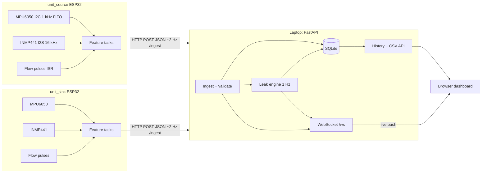

# Water Leakage Detection Pipeline: Build Guide

A 5 ft test pipe, two identical ESP32 sensor units, Wi-Fi to a laptop server, leak detection, live dashboard.

## Table of contents

0. [Assumptions: verify these on your parts](#0-assumptions--verify-these-on-your-parts)
1. [System architecture](#1-system-architecture)
2. [Bill of materials and pipe assembly](#2-bill-of-materials-and-pipe-assembly)
3. [Wiring](#3-wiring)
4. [Step-by-step bring-up](#4-step-by-step-bring-up)
5. [Firmware](#5-firmware)
6. [Logging](#6-logging)
7. [Server](#7-server)
8. [Leak-detection algorithm](#8-leak-detection-algorithm)
9. [Dashboard](#9-dashboard)
10. [Test and validation procedure](#10-test-and-validation-procedure)
11. [Troubleshooting table](#11-troubleshooting-table)
12. [Safety notes](#12-safety-notes)
13. [Future improvements](#13-future-improvements)

---

## 0. Assumptions: verify these on your parts

| # | Assumption | How to verify |
|---|-----------|---------------|
| A1 | Board = **ESP32 DevKit V1, 38-pin** (ESP32-WROOM-32, CP2102 or CH340 USB). | Silkscreen on the board. Pin names below (`VIN`, `3V3`, `D21`...) follow this board. |
| A2 | Hose = orange braided PVC, **~8 mm inner diameter (≈12 mm outer)**. The barbed nylon T in your photo looks like an 8 mm barb. | Measure with calipers or a drill bit. **Buy fittings to match what you actually measure.** |
| A3 | Flow sensor **Saier SEN-HZ41WC**: brass body, **G1/2" (BSP) male threads**, Hall-effect rotor, 3 wires (red = V+, black = GND, yellow = signal), supply **≈4.5–18 V DC**, range ≈1–30 L/min, pulse rate listed as **F ≈ 98 × Q (Hz, Q in L/min)**, i.e. ≈ **5880 pulses/litre**. I'm not certain of that figure, so treat it as a starting guess and **calibrate** (§4c). | Datasheet or seller page. The photo shows a yellow wire at the fitting; confirm wire colours with a multimeter. |
| A4 | Flow output is an **open-collector (NPN)** pulse output that needs a pull-up. | Measurement procedure in §3.3. **Do not connect the signal wire to a GPIO before you measure.** |
| A5 | Flow direction: water must follow the **arrow stamped on the body**. | Look for the arrow. Flowmeter B (source) is upstream, A (sink) is downstream. |
| A6 | MPU6050 = GY-521 module (3.3 V OK, AD0 → GND → address 0x68). INMP441 = 6-pin breakout (VDD, GND, L/R, WS, SCK, SD). | Run the I2C scanner (§4a). |
| A7 | Water supply: tap or small pump delivering **≥ 2 L/min**. | The flowmeter's usable minimum is ≈1 L/min. |
| A8 | Toolchain: **PlatformIO** (VS Code) with `espressif32@6.9.0` (Arduino-ESP32 core **2.0.17**), or Arduino IDE with ESP32 core **2.0.17**. | Core 3.x changed the I2S API. This guide uses the legacy driver, so pin the core to 2.0.x. |
| A9 | Server = laptop, Python ≥ 3.10, same Wi-Fi as the ESP32s (2.4 GHz). | `python --version` |

**Pipe layout and naming (my reading of your sketch).** The sketch is the source of truth:

```
SOURCE ─ H1 1.75ft ─ FM_B ─ H2 0.75ft ─ [ T ] ─ H3 0.75ft ─ FM_A ─ H4 1.75ft ─ SINK
          ▲ unit_source          leak ┘                         ▲ unit_sink
          (MPU+mic clamped on H1)  (3rd port)                   (MPU+mic clamped on H4)
```

* `unit_source` = ESP32 "B" + FM_B (upstream flowmeter). Its MPU/mic sit on H1.
* `unit_sink` = ESP32 "A" + FM_A (downstream flowmeter). Its MPU/mic sit on H4.
* The T is **between** the flowmeters. A leak at the T branch means **Q_source > Q_sink**.
* Total hose = 1.75 + 0.75 + 0.75 + 1.75 = **5.0 ft** (fittings and meters add a few cm).
* Distances are configurable on the server (`transit_volume_l`) and are used for the transit-delay calculation. Localisation in §8 assumes the T is roughly in the middle.

---

## 1. System architecture



```
 Sensors            ESP32 (per unit)                    Laptop (server)                    Browser
 ───────            ────────────────                    ───────────────                    ───────
 MPU6050 ─I2C 1kHz→ core1: mpuTask  ┐
 INMP441 ─I2S 16k─→ core1: micTask  ├→ features/0.5 s → core0: netTask ─ring buf─ HTTP POST ─→ /ingest ─→ SQLite
 Flow    ─pulse───→ ISR counter     ┘                  Wi-Fi + NTP + OTA     2 Hz/unit        │  └→ detector (1 Hz) → events
                                                                                               └→ WebSocket /ws ───────────→ charts
```

| Flow | Rate | Size | Notes |
|---|---|---|---|
| ESP32 → server `POST /ingest` | 1 message per 512 ms per unit (≈2 Hz) | ≈0.8 KB JSON | Feature summaries only |
| Server → dashboard `sample` | same as ingest | ≈0.8 KB | forwarded as-is |
| Server → dashboard `status` | 1 Hz | ≈1.5 KB | leak score, state, flows, unit health |
| Dashboard → server REST | on demand | small | config, baseline, history, CSV |

**Why summaries and not raw audio?** Raw 16 kHz × 16-bit audio is 32 KB/s per unit. That is about 10× the whole feature stream and would saturate ESP32 Wi-Fi, TCP buffers and SQLite for no gain, because the leak decision needs spectral energy, not waveforms. We send ≈0.8 KB per 0.5 s (≈1.6 KB/s) with enough spectral detail (5 bands plus a 16-bin spectrum) to see the hiss. If you later want raw snippets for ML, add an on-demand burst: record 1 s into RAM (32 KB) and POST it to a `/raw` endpoint. That is listed in §13 and is deliberately not in the base build.

**Why HTTP POST (not MQTT)?** One less moving part: no broker to install, you can test with `curl`, and requests show up in the server log. Cost: slightly more overhead per message and no broker-side buffering, which the firmware ring buffer replaces. WebSocket is used only server → browser. MQTT is in §13.

---

## 2. Bill of materials and pipe assembly

### 2.1 What you have

2× ESP32 DevKit V1, 2× MPU6050, 2× INMP441, 2× SEN-HZ41WC, jumper wires, orange braided hose (~5 ft), nylon barbed T (and elbows).

### 2.2 What to buy

| Item | Qty | Required? | Why |
|---|---|---|---|
| **10 kΩ resistor** (¼ W) | 2 (buy 10) | **Required** | Pull-up for each flow sensor's open-collector output (to **3.3 V**) |
| **20 kΩ + 10 kΩ resistors** | 2 each | Optional | Divider only if your flow output turns out to be push-pull 5 V (§3.3) |
| Mini breadboard (170 pts) or half-size | 2 | **Strongly recommended** | Used as a hub for 3V3 / GND / 5V and to hold the resistor. Wire-to-wire chains are the main source of faults. |
| Wago 221 lever connector, 3-way (or 3-pin screw terminal) | 2–4 | Recommended | Join the flow sensor's bare/JST wires to jumper wires with no solder |
| Male header strips (2.54 mm) | 1 | If your GY-521/INMP441 came without pins | Push-fit option in §3.6, soldering is better |
| **G1/2" BSP male thread → hose barb adapters** (barb size = your hose ID, e.g. 8 mm) | **4** (2 per flowmeter) | **Required** | Flowmeter ports are threaded; hose is not. If the meter has *female* ports, buy male-thread adapters; if *male*, buy female-thread ones. |
| PTFE (plumber's) tape | 1 roll | **Required** | Seal threads |
| Worm-drive hose clamps (to fit 12 mm OD hose) | 12 | **Required** | 2 per barb (T has 3 barbs, adapters have 4) |
| USB cables (good quality, short) + 5 V / 2 A phone chargers (or power banks) | 2 each | **Required** | One per unit. Cheap thin cables cause brownouts. Some power banks switch off at low current. |
| Zip ties, double-sided foam tape, small zip-lock bag or plastic box | assorted | **Required** | Mounting, keep boards dry |
| Epoxy putty or hot glue | 1 | Recommended | Rigid bond for the MPU6050 |
| Short (10 cm) hose + **pinch clamp or small ball valve** for the T branch | 1 | **Required** | Controlled "leak" |
| 1–2 L measuring jug and a stopwatch (phone) | 1 | **Required** | Flow calibration and leak volume |
| Multimeter | 1 | Optional, strongly recommended | Checks flow output type and voltages |
| 100 µF electrolytic capacitor | 2 | Optional | Across flowmeter supply for noise |
| Water source: tap adapter, or 12 V DC diaphragm / submersible pump + 12 V 2 A adapter + bucket | 1 | One of these | Needs ≥2 L/min. Keep the pump adapter dry and off the floor. |

### 2.3 Hydraulic assembly

```
 SOURCE → [H1] → [adapter→FM_B→adapter] → [H2] → T → [H3] → [adapter→FM_A→adapter] → [H4] → SINK
                                                  └─ branch: 10 cm hose + pinch clamp → into a bucket
```

1. Cut the hose into **4 pieces**: H1 = 1.75 ft (53 cm), H2 = 0.75 ft (23 cm), H3 = 0.75 ft (23 cm), H4 = 1.75 ft (53 cm). Cut squarely with a sharp blade.
2. **Flowmeters:** wrap 5–6 turns of PTFE tape clockwise on each male thread, screw in the adapter hand-tight plus ¼ turn with a spanner. Brass strips easily, so don't over-tighten.
3. **Direction:** the arrow on each flowmeter must point **toward the sink**. Reverse flow gives zero or wrong counts.
4. **Barbs:** push the hose fully over each barb. For stiff braided hose, soften the end in hot water for 10 s. Fit **two clamps per joint** and tighten until the hose just starts to bulge.
5. **T-joint:** run in from H2, run out to H3, **branch = the leak port**. Attach the 10 cm branch hose with a pinch clamp. Its free end drains into a bucket (so you can measure leaked volume with the jug).
6. **Sink:** end of H4 goes into a bucket or drain **below** the pipe level. Keep the pipe roughly horizontal and avoid air pockets (bleed by running water for 1 minute).
7. **Leak-test the plumbing before wiring anything.** Run water for 5 min. No drips at the clamps, adapters or T (except via the branch).

### 2.4 Sensor mounting (where signal quality is won or lost)

| Sensor | How | Why / caveat |
|---|---|---|
| **MPU6050** | Glue or zip-tie the module **flat on a rigid saddle** (a 3 cm piece of plastic strip, or a lump of epoxy putty) and clamp the saddle to the hose with a hose clamp. Prefer **rigid parts** (T body, brass adapter) if reachable. Any orientation works because we use the vector magnitude. | A soft braided hose damps vibration a lot. A loosely taped module measures its own wobble. Rigid coupling matters more than any software tuning. |
| **INMP441** | Mic port (small hole on the board) **facing the hose wall, 3–5 mm away**, board held with a zip tie. Wrap a small piece of foam around the board edges to cut room noise. Do **not** touch the port with tape or glue. | It is an *air* microphone, so room noise (voices, fans, pump) also gets in. Always baseline in the same environment you will test in. |
| **Distance from flowmeter** | Mount both sensors **≥ 20 cm from the flowmeter** (H1 is 53 cm, so put them near its middle). | The Hall flowmeter's spinning rotor is itself a vibration/noise source. Right next to it you measure the meter, not the leak. |
| **ESP32 board** | In a zip-lock bag or box next to its flowmeter, **away from the water path**, USB cable strain-relieved with a zip tie. | The flow cable is short (~25–30 cm). Keep the ESP32 within reach. |

---

## 3. Wiring

### 3.1 Pin mapping (identical for both units)

| Function | Sensor pin | ESP32 pin | GPIO | Notes |
|---|---|---|---|---|
| I2C SDA | MPU6050 SDA | D21 | **21** | Default I2C pin |
| I2C SCL | MPU6050 SCL | D22 | **22** | Default I2C pin |
| MPU power | VCC | 3V3 | n/a | 3.3 V |
| MPU ground | GND | GND | n/a | |
| MPU address | **AD0** | GND | n/a | AD0 low → **0x68** (high = 0x69). Never leave it floating. |
| MPU INT, XDA, XCL | n/c | n/a | n/a | Unused |
| I2S bit clock | INMP441 **SCK** | D26 | **26** | BCLK, 16 kHz × 64 = 1.024 MHz |
| I2S word select | INMP441 **WS** | D25 | **25** | LRCLK |
| I2S data in | INMP441 **SD** | D33 | **33** | Data out of mic, into ESP32 |
| Mic channel | INMP441 **L/R** | GND | n/a | **GND = left channel.** Floating = random/noisy. Firmware reads LEFT. |
| Mic power | VDD | 3V3 | n/a | 3.3 V **only** (never 5 V) |
| Mic ground | GND | GND | n/a | |
| Flow signal | Yellow | D27 | **27** | with 10 kΩ pull-up to **3V3** (§3.3) |
| Flow power | Red | **VIN** (5 V from USB) | n/a | 5 V supply |
| Flow ground | Black | GND | n/a | **Common ground is mandatory** |

**Why these GPIOs.**

* **Avoided:** strapping pins 0, 2, 5, 12, 15 (a sensor pulling them at reset can stop boot or select the wrong flash voltage), 6–11 (internal flash), 1/3 (USB serial), and 34–39 (input-only, with **no internal pull-up**, so you lose the fallback pull-up).
* 21/22 are the standard I2C pair. 25/26/33 are plain I/O and can be routed to the I2S peripheral. 27 is a plain interrupt-capable I/O with no boot function.
* ADC2 pins (25, 26, 27) can't be used with `analogRead` while Wi-Fi is on, but we don't use the ADC.

### 3.2 Power budget

| Part | Supply | Current (approx.) |
|---|---|---|
| ESP32 + Wi-Fi | USB 5 V → on-board 3.3 V regulator | 80–250 mA bursts |
| MPU6050 | 3V3 | ~4 mA |
| INMP441 | 3V3 | ~1.5 mA |
| SEN-HZ41WC | VIN (5 V) | ~5–15 mA |

All of this fits one USB port. The failure mode is **a bad USB cable or charger** that sags during Wi-Fi bursts, which shows up as `Brownout detector was triggered` (see §11).

### 3.3 The flow sensor: 5 V supply vs 3.3 V GPIO

The Hall sensor needs **≥ ~4.5 V** (most such meters list 4.5–18 V, so don't run it at 3.3 V). The ESP32 GPIO tolerates **3.3 V max**. The safe pattern depends on the output stage, which you can measure in two minutes.

**Test (multimeter, sensor powered from 5 V, signal wire connected to nothing but the meter's DC-volts probe vs GND):**

| Reading at rest (rotor not turning, nothing else connected) | Output type | What to do |
|---|---|---|
| ≈ 0 V, floating, or slowly drifting | **Open-collector (expected)** | **Pull-up resistor from signal to 3V3** (10 kΩ). The line can then never exceed 3.3 V, so no divider is needed. This is the wiring used in this guide. |
| Solid ~5 V (or ~4.x V) | Push-pull or internal pull-up to 5 V | **Divider:** signal → **10 kΩ** → GPIO27, and GPIO27 → **20 kΩ** → GND. Gives 5 × 20/30 = **3.33 V**. Do **not** add the 3V3 pull-up. |

```
 OPEN-COLLECTOR (default)                 PUSH-PULL 5 V (alternative)

 3V3 ──[10k]──┬── GPIO27                  Yellow ──[10k]──┬── GPIO27
 Yellow ──────┘                                            └──[20k]── GND
```

The firmware also enables the ESP32's internal pull-up (~45 kΩ) as a safety net, but the external 10 kΩ is what makes the edges clean.

### 3.4 Warnings

* **INMP441 L/R pin:** tie to GND (left). Floating L/R gives noise or silence.
* **MPU6050 AD0:** tie to GND (0x68). Floating can randomly change the address.
* **Common ground:** all grounds (ESP32, MPU, mic, flow black wire) joined. Missing ground to the flow sensor gives phantom pulses or none.
* **I2S wires ≤ 15 cm**, and don't bundle SCK next to SD. A 1 MHz clock on long loose jumpers causes crackle and zeroed data.
* **Never** connect INMP441 or MPU6050 VCC to 5 V *(the INMP441 would be damaged; the GY-521 has a regulator but its pull-ups/logic then sit at 5 V)*.

### 3.5 ASCII wiring diagram (one unit)

```
                         ┌───────────────── ESP32 DevKit V1 ──────────────┐
                         │ (USB 5V in)                                    │
  MPU6050 (GY-521)       │                                                │
   VCC ──────────────────┤ 3V3                                            │
   GND ──────────────────┤ GND                                            │
   SDA ──────────────────┤ D21 (GPIO21)                                   │
   SCL ──────────────────┤ D22 (GPIO22)                                   │
   AD0 ──────────────────┤ GND                                            │
                         │                                                │
  INMP441                │                                                │
   VDD ──────────────────┤ 3V3                                            │
   GND ──────────────────┤ GND                                            │
   L/R ──────────────────┤ GND   (left channel)                           │
   SCK ──────────────────┤ D26 (GPIO26)                                   │
   WS  ──────────────────┤ D25 (GPIO25)                                   │
   SD  ──────────────────┤ D33 (GPIO33)                                   │
                         │                                                │
  SEN-HZ41WC flow        │                                                │
   Red    (V+) ──────────┤ VIN (5V)                                       │
   Black  (GND) ─────────┤ GND                                            │
   Yellow (sig) ─┬───────┤ D27 (GPIO27)                                   │
                 └─[10k]─┤ 3V3          (pull-up to 3.3V)                 │
                         └────────────────────────────────────────────────┘
        Use a mini breadboard as a 3V3 / GND / 5V hub so each rail has a few holes.
```

### 3.6 No-solder connection approach, and where it's fragile

* **ESP32 pins:** female jumper ends onto the board's header pins. Most reliable part.
* **GY-521 / INMP441:** if headers are already soldered, use female jumpers. If they arrived as loose strips, **push the strip into the breadboard and press the module onto it** (friction fit), or hold pins slightly angled in the holes and fix with a blob of hot glue. Soldering 6 pins takes 5 minutes and is far better. Borrow an iron if you can.
* **Flow sensor wires:** strip 5 mm, put each wire and a jumper's cut end into a **Wago 221** lever slot (or screw terminal). Twisting a wire into a female jumper works for a quick test, but it falls out.
* **Resistor:** push the legs into the breadboard hub.
* **Fragile points:** (1) any jumper joined to another jumper, (2) the flow-sensor connection (vibration + water tugging on the cable), (3) I2S wires moving around (crackle). **Fix:** zip-tie wires to the board, add strain relief 10 cm from each connector, and tape the whole bundle flat to a piece of cardboard. Re-seat everything first if a sensor "randomly" disappears.

---

## 4. Step-by-step bring-up

Test each sensor on its own **before** integrating. Create the project (§5.1) first so these sketches can share `config.h`, or paste them into a fresh Arduino IDE sketch with the pin defines at the top.

PlatformIO environments for the four stages (in `platformio.ini`, §5.2):

```
pio run -e bringup_a -t upload && pio device monitor -e bringup_a   # I2C scan + MPU
pio run -e bringup_b -t upload && pio device monitor -e bringup_b   # mic RMS
pio run -e bringup_c -t upload && pio device monitor -e bringup_c   # flow + calibration
pio run -e bringup_d -t upload && pio device monitor -e bringup_d   # all sensors, FreeRTOS, no Wi-Fi
```

Files live in `bringup/`.

### 4a. I2C scanner and MPU6050: `bringup/a_i2c_scan.cpp`

```cpp
#include <Arduino.h>
#include <Wire.h>
#include "config.h"

static bool readRegs(uint8_t addr, uint8_t reg, uint8_t *buf, size_t n) {
  Wire.beginTransmission(addr);
  Wire.write(reg);
  if (Wire.endTransmission(false) != 0) return false;
  if (Wire.requestFrom((uint16_t)addr, (size_t)n, true) != n) return false;
  for (size_t i = 0; i < n; i++) buf[i] = Wire.read();
  return true;
}

void setup() {
  Serial.begin(115200);
  delay(500);
  Wire.begin(PIN_I2C_SDA, PIN_I2C_SCL);
  Wire.setClock(100000);
  Serial.printf("\nI2C scan  SDA=GPIO%d  SCL=GPIO%d\n", PIN_I2C_SDA, PIN_I2C_SCL);
}

void loop() {
  int found = 0;
  uint8_t mpu = 0;
  for (uint8_t a = 1; a < 127; a++) {
    Wire.beginTransmission(a);
    if (Wire.endTransmission() == 0) {
      bool isMpu = (a == 0x68 || a == 0x69);
      Serial.printf("  found 0x%02X%s\n", a, isMpu ? "  <- MPU6050 (expected)" : "");
      if (isMpu) mpu = a;
      found++;
    }
  }
  if (!found) {
    Serial.println("  NOTHING FOUND -> check 3V3/GND, SDA/SCL not swapped, loose jumper");
  } else if (mpu) {
    // wake the chip, then read WHO_AM_I and acceleration
    Wire.beginTransmission(mpu); Wire.write(0x6B); Wire.write(0x00); Wire.endTransmission();
    delay(50);
    uint8_t who = 0, d[6];
    readRegs(mpu, 0x75, &who, 1);
    if (readRegs(mpu, 0x3B, d, 6)) {
      float ax = (int16_t)((d[0] << 8) | d[1]) / 16384.0f;
      float ay = (int16_t)((d[2] << 8) | d[3]) / 16384.0f;
      float az = (int16_t)((d[4] << 8) | d[5]) / 16384.0f;
      Serial.printf("  WHO_AM_I=0x%02X  accel[g] x=%.3f y=%.3f z=%.3f  |a|=%.3f\n",
                    who, ax, ay, az, sqrtf(ax * ax + ay * ay + az * az));
    }
  }
  delay(2000);
}
```

**Expected output**

```
I2C scan  SDA=GPIO21  SCL=GPIO22
  found 0x68  <- MPU6050 (expected)
  WHO_AM_I=0x68  accel[g] x=0.012 y=-0.031 z=0.998  |a|=1.000
```

* `|a|` should be ≈ 1.00 g when still. Tilt the module and watch the axes shift.
* WHO_AM_I is usually 0x68. Clones report 0x70, 0x72 or 0x98 and still work.

**Troubleshooting:** nothing found → swap SDA/SCL, re-seat jumpers, confirm 3V3 (not 5 V) at the module. Found at 0x69 → AD0 is high, so tie it to GND (or change `MPU_ADDR`). Found at random addresses → loose wiring.

### 4b. INMP441 I2S capture and RMS check: `bringup/b_mic_rms.cpp`

```cpp
#include <Arduino.h>
#include "driver/i2s.h"
#include "config.h"

void setup() {
  Serial.begin(115200);
  delay(500);

  i2s_config_t cfg = {};
  cfg.mode = (i2s_mode_t)(I2S_MODE_MASTER | I2S_MODE_RX);
  cfg.sample_rate = MIC_FS_HZ;
  cfg.bits_per_sample = I2S_BITS_PER_SAMPLE_32BIT;
  cfg.channel_format = I2S_CHANNEL_FMT_ONLY_LEFT;      // L/R pin = GND
  cfg.communication_format = I2S_COMM_FORMAT_STAND_I2S;
  cfg.intr_alloc_flags = ESP_INTR_FLAG_LEVEL1;
  cfg.dma_buf_count = 8;
  cfg.dma_buf_len = 256;
  cfg.use_apll = false;
  if (i2s_driver_install(I2S_NUM_0, &cfg, 0, NULL) != ESP_OK) { Serial.println("i2s install FAILED"); while (1) delay(1000); }

  i2s_pin_config_t pins = {};
  pins.mck_io_num = I2S_PIN_NO_CHANGE;
  pins.bck_io_num = PIN_I2S_BCLK;
  pins.ws_io_num = PIN_I2S_WS;
  pins.data_out_num = I2S_PIN_NO_CHANGE;
  pins.data_in_num = PIN_I2S_SD;
  i2s_set_pin(I2S_NUM_0, &pins);
  Serial.println("INMP441 test: tap the board, clap, talk. The level should jump.");
}

void loop() {
  static int32_t raw[256];
  static double sumSq = 0, sum = 0;
  static int n = 0;
  size_t got = 0;
  esp_err_t e = i2s_read(I2S_NUM_0, raw, sizeof(raw), &got, pdMS_TO_TICKS(200));
  if (e != ESP_OK || got == 0) { Serial.println("I2S read TIMEOUT -> check SCK/WS/SD wiring"); return; }
  for (size_t i = 0; i < got / 4; i++) {
    double s = (raw[i] >> 8) / 8388608.0;   // 24-bit signed -> +-1.0
    sum += s; sumSq += s * s; n++;
  }
  if (n >= MIC_FS_HZ / 10) {                // every 100 ms
    double mean = sum / n;
    double rms = sqrt(sumSq / n - mean * mean);
    float db = 20.0f * log10f((float)rms + 1e-9f);
    int bar = constrain((int)((db + 90.0f) * 0.6f), 0, 54);
    char b[64]; memset(b, '#', bar); b[bar] = 0;
    Serial.printf("%7.1f dBFS  dc=%+.5f  %s\n", db, mean, b);
    sum = sumSq = 0; n = 0;
  }
}
```

**Expected output**

```
  -62.3 dBFS  dc=-0.00112  ####################
  -61.8 dBFS  dc=-0.00110  #####################
  -35.2 dBFS  dc=-0.00108  ######################################    ← you clapped
```

* Quiet room: roughly **−70 to −55 dBFS**. Clap or tap: **jumps 20+ dB**. That is the pass criterion.
* **Stuck at ≈ −120 / `0.0000` or never changes** → L/R not on GND, SD/WS/SCK wrong, or no 3V3. **Timeouts** → SCK/WS not reaching the mic.
* Loud crackling → I2S wires too long or touching.

### 4c. Flow sensor: pulse counting, L/min, calibration: `bringup/c_flow_calib.cpp`

```cpp
#include <Arduino.h>
#include "config.h"

static volatile uint32_t pulses = 0, lastUs = 0;
static void IRAM_ATTR isr() {
  uint32_t now = (uint32_t)micros();
  if ((uint32_t)(now - lastUs) >= FLOW_MIN_PULSE_US) { pulses++; lastUs = now; }
}

void setup() {
  Serial.begin(115200);
  delay(500);
  pinMode(PIN_FLOW, INPUT_PULLUP);                    // plus the external 10k to 3V3
  attachInterrupt(digitalPinToInterrupt(PIN_FLOW), isr, FALLING);
  Serial.printf("Flow test. K=%.1f pulses/L (config).  Commands:  r = reset   c<litres> = calibrate, e.g. c2.0\n",
                FLOW_PULSES_PER_LITER);
}

void loop() {
  static uint32_t lastP = 0, lastMs = millis();
  uint32_t now = millis();
  if (now - lastMs >= 1000) {
    uint32_t p = pulses, dp = p - lastP;
    float dt = (now - lastMs) / 1000.0f;
    float hz = dp / dt;
    float lpm = (dp / FLOW_PULSES_PER_LITER) * 60.0f / dt;
    Serial.printf("total=%lu  +%lu pulses/s  %.1f Hz  %.2f L/min  %.3f L\n",
                  (unsigned long)p, (unsigned long)dp, hz, lpm, p / FLOW_PULSES_PER_LITER);
    lastP = p; lastMs = now;
  }
  if (Serial.available()) {
    String s = Serial.readStringUntil('\n'); s.trim();
    if (s == "r") { noInterrupts(); pulses = 0; interrupts(); Serial.println("counter reset"); }
    else if (s.startsWith("c")) {
      float litres = s.substring(1).toFloat();
      if (litres > 0) {
        Serial.printf("CALIBRATION: %lu pulses / %.3f L = %.1f pulses per litre  -> set FLOW_PULSES_PER_LITER in config.h\n",
                      (unsigned long)pulses, litres, pulses / litres);
      }
    }
  }
}
```

**Calibration procedure (bucket method):**

1. Flash `bringup_c`, assemble the pipe (both flowmeters can be tested separately by moving the sensor to this ESP32).
2. Run water at your normal test flow. Type `r` to zero the counter, then **direct the sink hose into a measuring jug** for a known volume (≥ 2 L; more is better because the error is ±1 pulse).
3. Stop the water exactly at the mark and type `c2.0` (use the real volume). The sketch prints **pulses per litre**.
4. Repeat 3 times, average, and write the value into `FLOW_PULSES_PER_LITER` in `config.h` **for that specific meter**. The two meters may differ by a few % (that difference is handled by the flow-bias baseline, §8).
5. Verify against the datasheet. If your result is 10× different from the figure in A3 (≈5880), you have a different K-factor or a different meter than assumed. **Trust your measurement.**

**Expected output with no water:** `+0 pulses/s  0.00 L/min`. With water: a few hundred Hz at 3 L/min (≈ 98 × 3 = 294 Hz if A3 is right).

**Flow reads zero?** Check: arrow direction, red wire really on 5 V, black on GND, pull-up present, signal wire on GPIO27, flow too low (<1 L/min), rotor jammed by debris (blow gently through the meter). Spurious counts at standstill → floating signal (missing pull-up), or long wire picking up noise.

### 4d. All three together: FreeRTOS, no Wi-Fi

`bringup_d` compiles the real firmware with `-DENABLE_NET=0`: same sensor code as production, results printed to serial instead of sent. **Why the task layout is what it is:**

| Task | Core | Priority | Why |
|---|---|---|---|
| `mpuTask` (FIFO drain every 20 ms) | 1 | 4 | Timing sensitive but cheap thanks to the MPU's hardware FIFO (no 1 kHz polling). |
| `micTask` (I2S DMA read + FFT) | 1 | 3 | Continuous, FFT is ~10 ms per 128 ms window. |
| flow ISR | any | n/a | Hardware interrupt, increments a counter only. |
| `netTask` (Wi-Fi, HTTP, NTP, OTA) | **0** | 2 | The Wi-Fi/TCP stack already runs on core 0; keeping network blocking calls there means a slow server never delays sampling. |
| `loop()` | 1 | 1 | Idle (or prints in bench mode). |

Nothing in the sensor path blocks on the network: sensors write snapshots under a mutex, the network task reads them.

**Expected serial output (bench mode):**

```
[      512][--:--:--][I][bench] Q=0.00 L/min tot=0.000 L | vib rms=6.1/5.8/7.9 mg peak=24 mg dom=118 Hz | mic -61.2 dBFS cen=1450 Hz | ok mpu=1 mic=1
[     1024][--:--:--][I][bench] Q=2.94 L/min tot=0.025 L | vib rms=14.2/11.0/18.5 mg peak=71 mg dom=146 Hz | mic -48.3 dBFS cen=2250 Hz | ok mpu=1 mic=1
```

Pass criteria: `mpu=1 mic=1`, vibration RMS rises when you tap the pipe, mic dB rises when water runs, Q matches your jug measurement within ~5 %.

---

## 5. Firmware

### 5.1 Project structure (PlatformIO)

```
firmware/
├── platformio.ini
├── include/
│   ├── config.h        # Wi-Fi, unit ID, server URL, pins, K-factor, rates
│   ├── logging.h       # leveled logging macros
│   └── dsp.h           # FFT + window helpers (no external library)
├── src/
│   ├── main.cpp
│   ├── sensors.h
│   ├── sensors.cpp     # flow ISR, MPU6050 FIFO task, INMP441 I2S task
│   ├── net.h
│   └── net.cpp         # Wi-Fi, NTP, ring buffer, HTTP POST, OTA, watchdog
└── bringup/
    ├── a_i2c_scan.cpp
    ├── b_mic_rms.cpp
    └── c_flow_calib.cpp
```

**Arduino IDE instead:** install *esp32 by Espressif Systems* **2.0.17** in Boards Manager, select **ESP32 Dev Module**, install **ArduinoJson 7.2.x** in Library Manager. Make a folder `leak_unit/`, rename `main.cpp` → `leak_unit.ino`, and put **all** the `.h` and `.cpp` files (including those from `include/`) in that same folder. Set the unit by editing `UNIT_ID` in `config.h` before each upload. Don't flash a 3.x core: the legacy I2S driver used here is deprecated there.

### 5.2 `platformio.ini`

```ini
[platformio]
src_dir = src
include_dir = include

[env]
platform = espressif32@6.9.0     ; Arduino-ESP32 core 2.0.17
board = esp32dev
framework = arduino
monitor_speed = 115200
monitor_filters = esp32_exception_decoder, time
lib_deps = bblanchon/ArduinoJson@^7.2.0
build_flags = -DCORE_DEBUG_LEVEL=0 -DLOG_LEVEL=3    ; 1=ERR 2=WARN 3=INFO 4=DEBUG

[env:unit_source]
build_flags = ${env.build_flags} -DUNIT_ID=\"unit_source\"

[env:unit_sink]
build_flags = ${env.build_flags} -DUNIT_ID=\"unit_sink\"

[env:unit_source_debug]
build_flags = ${env.build_flags} -DUNIT_ID=\"unit_source\" -ULOG_LEVEL -DLOG_LEVEL=4

; ---- bring-up sketches (each replaces main.cpp) ----
[env:bringup_a]
build_src_filter = -<*> +<../bringup/a_i2c_scan.cpp>
[env:bringup_b]
build_src_filter = -<*> +<../bringup/b_mic_rms.cpp>
[env:bringup_c]
build_src_filter = -<*> +<../bringup/c_flow_calib.cpp>
[env:bringup_d]                     ; full sensor firmware, serial output only
build_flags = ${env.build_flags} -DUNIT_ID=\"bench\" -DENABLE_NET=0
```

Upload: `pio run -e unit_source -t upload` (and `-e unit_sink` for the second board). Monitor: `pio device monitor -e unit_source`. If upload hangs on "Connecting…", hold the **BOOT** button until it starts.

### 5.3 Payload schema

One JSON object per message (the server also accepts a JSON array of them):

```json
{
  "unit": "unit_source",
  "fw": "1.0.0",
  "seq": 1042,
  "ts": 1761640512345,
  "time_ok": true,
  "ms": 523912,
  "flow": { "lpm": 2.94, "total_l": 12.381, "pulses": 72801, "active": true },
  "vib":  { "ok": true, "rms": [0.0142, 0.0110, 0.0185], "peak": 0.071, "dom_hz": 146.5,
            "bands": [-52.1, -44.3, -48.9, -57.0] },
  "mic":  { "ok": true, "db": -48.3, "centroid": 2250.4,
            "bands": [-61.2, -54.0, -55.3, -58.8, -66.1],
            "spec": [-70.1, -68.4, -66.0, -63.2, -60.5, -58.1, -57.0, -56.2, -55.9, -56.8, -58.3, -60.2, -62.9, -65.0, -68.0, -71.1] },
  "sys":  { "rssi": -58, "heap": 182340, "up_s": 523, "reconnects": 1, "buf": 0, "drops": 0 }
}
```

| Field | Meaning |
|---|---|
| `ts` | UTC epoch **milliseconds** from NTP (`0` and `time_ok:false` until synced) |
| `ms` | `millis()` since boot, for ordering and drift analysis |
| `seq` | Per-boot message counter; gaps = lost messages |
| `flow.lpm` | Average flow in L/min over the interval since the previous message |
| `flow.active` | `false` if no pulses for 5 s |
| `vib.rms` | RMS acceleration (g) per axis, DC removed, 512-sample window (1 kHz → 0.512 s) |
| `vib.bands` | Relative dB (g²) in 5–50, 50–150, 150–300, 300–500 Hz |
| `vib.dom_hz` | Dominant frequency (≥5 Hz) of summed-axis spectrum |
| `mic.db` | RMS level in dBFS |
| `mic.bands` | dB (full-scale²) in 100–500, 500–1k, 1–2k, 2–4k, 4–8k Hz |
| `mic.spec` | 16 log-spaced bins, 100 Hz → 8 kHz, in dB (for the dashboard spectrum) |
| `sys.buf / drops` | Messages waiting in the offline ring buffer / dropped because it overflowed |

### 5.4 `include/config.h`

```cpp
#pragma once

#define FW_VERSION "1.0.0"

// ---------- Unit identity (set per board; platformio envs override via -DUNIT_ID) ----------
#ifndef UNIT_ID
#define UNIT_ID "unit_source"            // "unit_source" or "unit_sink"
#endif

// ---------- Feature switches ----------
#ifndef ENABLE_NET
#define ENABLE_NET 1                      // 0 = bench mode (serial output only)
#endif
#define ENABLE_OTA 0                      // 1 = ArduinoOTA (set OTA_PASSWORD!)

// ---------- Wi-Fi / server (EDIT THESE) ----------
#define WIFI_SSID     "YOUR_WIFI_NAME"    // 2.4 GHz network
#define WIFI_PASS     "YOUR_WIFI_PASSWORD"
#define SERVER_URL    "http://192.168.1.50:8000/ingest"   // laptop IP, find with ipconfig / ifconfig
#define OTA_PASSWORD  "change-me"
#define NTP_SERVER_1  "pool.ntp.org"
#define NTP_SERVER_2  "time.google.com"

// ---------- Pins (see README section 3) ----------
#define PIN_I2C_SDA   21
#define PIN_I2C_SCL   22
#define PIN_I2S_BCLK  26
#define PIN_I2S_WS    25
#define PIN_I2S_SD    33
#define PIN_FLOW      27

// ---------- Flow sensor ----------
// VERIFY / CALIBRATE: F = 98*Q (Hz, Q in L/min) -> 98*60 = 5880 pulses per litre (assumption!).
#define FLOW_PULSES_PER_LITER  5880.0f
#define FLOW_MIN_PULSE_US      150        // ignore edges closer than this (glitch filter, ~6.6 kHz max)
#define FLOW_IDLE_MS           5000       // no pulses for this long -> flow.active=false

// ---------- MPU6050 ----------
#define MPU_ADDR      0x68                // AD0 = GND
#define MPU_FS_HZ     1000                // fixed by SMPLRT_DIV below
#define MPU_WIN       512                 // samples per feature window (0.512 s) - power of 2

// ---------- INMP441 ----------
#define MIC_FS_HZ     16000
#define MIC_WIN       2048                // 128 ms per feature window - power of 2

// ---------- Publishing / buffering ----------
#define PUBLISH_PERIOD_MS 512
#define RING_SLOTS        48              // ~25 s of offline buffer
#define SLOT_BYTES        1024            // 48 KB heap total
#define HTTP_TIMEOUT_MS   2500
#define WIFI_RESTART_AFTER_MS 180000      // reboot if offline this long
#define WDT_TIMEOUT_S     30
```

### 5.5 `include/logging.h`

```cpp
#pragma once
#include <Arduino.h>
#include <stdarg.h>
#include <time.h>

// Compile-time level: 0 none, 1 ERROR, 2 WARN, 3 INFO, 4 DEBUG
#ifndef LOG_LEVEL
#define LOG_LEVEL 3
#endif

inline void logPrint(char lvl, const char *tag, const char *fmt, ...) {
  char msg[200];
  va_list ap;
  va_start(ap, fmt);
  vsnprintf(msg, sizeof(msg), fmt, ap);
  va_end(ap);

  char ts[16] = "--:--:--";                       // UTC wall-clock once NTP has synced
  time_t now = time(nullptr);
  if (now > 1700000000) {
    struct tm t;
    gmtime_r(&now, &t);
    strftime(ts, sizeof(ts), "%H:%M:%SZ", &t);
  }
  Serial.printf("[%9lu][%s][%c][%-5s] %s\n", (unsigned long)millis(), ts, lvl, tag, msg);
}

#define LOGE(tag, ...) do { if (LOG_LEVEL >= 1) logPrint('E', tag, __VA_ARGS__); } while (0)
#define LOGW(tag, ...) do { if (LOG_LEVEL >= 2) logPrint('W', tag, __VA_ARGS__); } while (0)
#define LOGI(tag, ...) do { if (LOG_LEVEL >= 3) logPrint('I', tag, __VA_ARGS__); } while (0)
#define LOGD(tag, ...) do { if (LOG_LEVEL >= 4) logPrint('D', tag, __VA_ARGS__); } while (0)
```

### 5.6 `include/dsp.h`

```cpp
#pragma once
#include <math.h>

// In-place iterative radix-2 FFT. n must be a power of two.
inline void fft(float *re, float *im, int n) {
  for (int i = 1, j = 0; i < n; i++) {                 // bit-reversal permutation
    int bit = n >> 1;
    for (; j & bit; bit >>= 1) j ^= bit;
    j ^= bit;
    if (i < j) {
      float t = re[i]; re[i] = re[j]; re[j] = t;
      t = im[i]; im[i] = im[j]; im[j] = t;
    }
  }
  for (int len = 2; len <= n; len <<= 1) {
    float ang = -2.0f * (float)M_PI / len;
    float wr = cosf(ang), wi = sinf(ang);
    for (int i = 0; i < n; i += len) {
      float cr = 1.0f, ci = 0.0f;
      for (int k = 0; k < len / 2; k++) {
        int a = i + k, b = i + k + len / 2;
        float tr = re[b] * cr - im[b] * ci;
        float ti = re[b] * ci + im[b] * cr;
        re[b] = re[a] - tr; im[b] = im[a] - ti;
        re[a] += tr;        im[a] += ti;
        float ncr = cr * wr - ci * wi;
        ci = cr * wi + ci * wr;
        cr = ncr;
      }
    }
  }
}

inline void hannWindow(float *x, int n) {
  for (int i = 0; i < n; i++) x[i] *= 0.5f * (1.0f - cosf(2.0f * (float)M_PI * i / (n - 1)));
}

// One-sided mean-square contribution of FFT bin k for a Hann-windowed frame (units: signal^2).
// Hann window power gain = 0.375.  Sum over k ~= mean square of the signal.
inline float binPower(float re, float im, int n) {
  return 2.0f * (re * re + im * im) / ((float)n * (float)n * 0.375f);
}

inline float toDb(float p) { return 10.0f * log10f(p + 1e-12f); }
```

### 5.7 `src/sensors.h`

```cpp
#pragma once
#include <Arduino.h>

struct FlowData { float lpm; float totalL; uint32_t pulses; bool active; };
struct VibData  { float rms[3]; float peak; float domHz; float bands[4]; bool ok; uint32_t seq; };
struct MicData  { float db; float centroid; float bands[5]; float spec[16]; bool ok; uint32_t seq; };

void     sensorsBegin();
FlowData flowSnapshot();   // flow averaged since the previous call
VibData  vibSnapshot();    // latest completed 512-sample window
MicData  micSnapshot();    // power-average of all windows since the previous call
```

### 5.8 `src/sensors.cpp`

```cpp
#include <Arduino.h>
#include <Wire.h>
#include "driver/i2s.h"
#include "config.h"
#include "logging.h"
#include "dsp.h"
#include "sensors.h"

static SemaphoreHandle_t g_mtx;

// =====================================================================
//  FLOW  (interrupt pulse counter)
// =====================================================================
static volatile uint32_t g_pulses = 0, g_lastIsrUs = 0;

static void IRAM_ATTR flowISR() {
  uint32_t now = (uint32_t)micros();
  if ((uint32_t)(now - g_lastIsrUs) >= FLOW_MIN_PULSE_US) {   // glitch / bounce filter
    g_pulses++;
    g_lastIsrUs = now;
  }
}

FlowData flowSnapshot() {
  static uint32_t lastP = 0, lastMs = 0, lastChangeMs = 0;
  static bool wasActive = true;
  uint32_t nowMs = millis();
  uint32_t p = g_pulses;
  if (lastMs == 0) { lastMs = nowMs; lastChangeMs = nowMs; }

  uint32_t dp = p - lastP;
  uint32_t dt = nowMs - lastMs;
  FlowData d;
  d.pulses = p;
  d.totalL = p / FLOW_PULSES_PER_LITER;
  d.lpm = dt ? (dp / FLOW_PULSES_PER_LITER) * 60000.0f / (float)dt : 0.0f;
  if (dp) lastChangeMs = nowMs;
  d.active = (nowMs - lastChangeMs) < FLOW_IDLE_MS;

  if (wasActive && !d.active) LOGW("flow", "no pulses for %d ms (water off, wrong direction, or sensor wiring)", FLOW_IDLE_MS);
  if (!wasActive && d.active) LOGI("flow", "pulses resumed");
  wasActive = d.active;
  lastP = p; lastMs = nowMs;
  return d;
}

// =====================================================================
//  MPU6050  (hardware FIFO @ 1 kHz, accel only)
// =====================================================================
static float s_ax[3][MPU_WIN];
static float s_re[MPU_WIN], s_im[MPU_WIN], s_pw[MPU_WIN / 2];
static VibData g_vib = {};

static bool mpuWrite(uint8_t reg, uint8_t val) {
  Wire.beginTransmission(MPU_ADDR);
  Wire.write(reg);
  Wire.write(val);
  return Wire.endTransmission() == 0;
}

static bool mpuRead(uint8_t reg, uint8_t *buf, size_t n) {
  Wire.beginTransmission(MPU_ADDR);
  Wire.write(reg);
  if (Wire.endTransmission(false) != 0) return false;
  if (Wire.requestFrom((uint16_t)MPU_ADDR, (size_t)n, true) != n) return false;
  for (size_t i = 0; i < n; i++) buf[i] = Wire.read();
  return true;
}

static bool mpuInit() {
  if (!mpuWrite(0x6B, 0x80)) return false;     // device reset
  delay(100);
  mpuWrite(0x6B, 0x01);                        // wake, clock = gyro X PLL
  delay(10);
  uint8_t who = 0;
  if (!mpuRead(0x75, &who, 1)) return false;
  LOGI("mpu", "WHO_AM_I=0x%02X", who);
  mpuWrite(0x1A, 0x00);                        // DLPF_CFG=0: accel BW 260 Hz (widest)
  mpuWrite(0x19, 7);                           // 8 kHz / (1+7) = 1 kHz sample rate
  mpuWrite(0x1C, 0x00);                        // accel full scale +-2 g (16384 LSB/g)
  mpuWrite(0x6A, 0x04);                        // FIFO reset
  delay(5);
  mpuWrite(0x23, 0x08);                        // FIFO: accelerometer only (6 bytes / sample)
  mpuWrite(0x6A, 0x40);                        // FIFO enable
  return true;
}

static void setVibOk(bool ok) {
  xSemaphoreTake(g_mtx, portMAX_DELAY);
  g_vib.ok = ok;
  xSemaphoreGive(g_mtx);
}

static void mpuProcess() {
  VibData v = {};
  float pk = 0;
  for (int k = 0; k < MPU_WIN / 2; k++) s_pw[k] = 0;
  for (int a = 0; a < 3; a++) {
    float mean = 0;
    for (int i = 0; i < MPU_WIN; i++) mean += s_ax[a][i];
    mean /= MPU_WIN;
    float ss = 0;
    for (int i = 0; i < MPU_WIN; i++) {
      float x = s_ax[a][i] - mean;                // remove gravity / DC
      s_re[i] = x; s_im[i] = 0;
      ss += x * x;
      if (fabsf(x) > pk) pk = fabsf(x);
    }
    v.rms[a] = sqrtf(ss / MPU_WIN);
    hannWindow(s_re, MPU_WIN);
    fft(s_re, s_im, MPU_WIN);
    for (int k = 1; k < MPU_WIN / 2; k++) s_pw[k] += binPower(s_re[k], s_im[k], MPU_WIN);
  }
  v.peak = pk;

  const float binHz = (float)MPU_FS_HZ / MPU_WIN;               // 1.953 Hz
  const float edges[5] = {5, 50, 150, 300, 500};
  float bp[4] = {0, 0, 0, 0}, best = 0; int bestK = 0;
  for (int k = 1; k < MPU_WIN / 2; k++) {
    float f = k * binHz;
    if (f >= 5 && s_pw[k] > best) { best = s_pw[k]; bestK = k; }
    for (int b = 0; b < 4; b++) if (f >= edges[b] && f < edges[b + 1]) bp[b] += s_pw[k];
  }
  v.domHz = bestK * binHz;
  for (int b = 0; b < 4; b++) v.bands[b] = toDb(bp[b]);

  xSemaphoreTake(g_mtx, portMAX_DELAY);
  v.ok = g_vib.ok;
  v.seq = g_vib.seq + 1;
  g_vib = v;
  xSemaphoreGive(g_mtx);
}

static void mpuTask(void *) {
  int n = 0, failCount = 0;
  uint32_t lastTry = 0;
  bool ok = mpuInit();
  setVibOk(ok);
  if (!ok) LOGE("mpu", "init failed (I2C wiring? address 0x%02X)", MPU_ADDR);

  for (;;) {
    vTaskDelay(pdMS_TO_TICKS(20));                // ~20 samples per wake-up
    if (!ok) {
      if (millis() - lastTry > 2000) {
        lastTry = millis();
        ok = mpuInit();
        setVibOk(ok);
        if (ok) { LOGI("mpu", "recovered"); failCount = 0; n = 0; }
      }
      continue;
    }
    uint8_t c[2];
    if (!mpuRead(0x72, c, 2)) {
      if (++failCount >= 5) { ok = false; setVibOk(false); LOGE("mpu", "I2C failure x5 -> sensor marked unhealthy"); }
      continue;
    }
    failCount = 0;
    uint16_t cnt = ((uint16_t)c[0] << 8) | c[1];
    if (cnt >= 1000) {                            // FIFO is 1024 B: overflow, resync
      LOGW("mpu", "FIFO overflow (%u bytes) - resetting", cnt);
      mpuWrite(0x6A, 0x00); mpuWrite(0x6A, 0x04); mpuWrite(0x6A, 0x40);
      continue;
    }
    int samples = cnt / 6;
    while (samples > 0) {
      int chunk = samples > 20 ? 20 : samples;    // 120 B fits in the 128 B Wire buffer
      uint8_t b[120];
      if (!mpuRead(0x74, b, chunk * 6)) { failCount++; break; }
      for (int i = 0; i < chunk; i++) {
        for (int a = 0; a < 3; a++) {
          int16_t raw = (int16_t)(((uint16_t)b[i * 6 + a * 2] << 8) | b[i * 6 + a * 2 + 1]);
          s_ax[a][n] = raw / 16384.0f;
        }
        if (++n == MPU_WIN) { mpuProcess(); n = 0; }
      }
      samples -= chunk;
    }
  }
}

VibData vibSnapshot() {
  xSemaphoreTake(g_mtx, portMAX_DELAY);
  VibData v = g_vib;
  xSemaphoreGive(g_mtx);
  return v;
}

// =====================================================================
//  INMP441  (I2S 16 kHz, left channel, 32-bit frames / 24-bit data)
// =====================================================================
static float m_buf[MIC_WIN], m_re[MIC_WIN], m_im[MIC_WIN];
static const float MIC_BAND_EDGES[6] = {100, 500, 1000, 2000, 4000, 8000};
static int specLo[16], specHi[16];

static struct {
  double ms, band[5], spec[16], cNum, cDen;
  int n;
} acc;
static MicData g_mic = {};

static void micInitBins() {
  const float binHz = (float)MIC_FS_HZ / MIC_WIN;
  for (int j = 0; j < 16; j++) {
    float lo = 100.0f * powf(80.0f, j / 16.0f);
    float hi = 100.0f * powf(80.0f, (j + 1) / 16.0f);
    specLo[j] = (int)roundf(lo / binHz);
    specHi[j] = (int)roundf(hi / binHz);
    if (specHi[j] <= specLo[j]) specHi[j] = specLo[j] + 1;
  }
}

static void micProcess() {
  static int flatCount = 0;
  const int N = MIC_WIN;
  float mean = 0;
  for (int i = 0; i < N; i++) mean += m_buf[i];
  mean /= N;
  float ms = 0;
  for (int i = 0; i < N; i++) { float x = m_buf[i] - mean; m_re[i] = x; m_im[i] = 0; ms += x * x; }
  ms /= N;

  if (ms < 1e-10f) {                              // below about -100 dBFS: essentially digital silence
    if (++flatCount == 40) LOGW("mic", "signal is flat (<-100 dBFS) - check L/R pin, SD/WS/SCK wiring, 3V3");
  } else flatCount = 0;

  hannWindow(m_re, N);
  fft(m_re, m_im, N);
  const float binHz = (float)MIC_FS_HZ / N;
  for (int k = 1; k < N / 2; k++) m_re[k] = binPower(m_re[k], m_im[k], N);   // m_re[k] := power

  double band[5] = {0}, cNum = 0, cDen = 0, spec[16] = {0};
  for (int k = 1; k < N / 2; k++) {
    float f = k * binHz, p = m_re[k];
    if (f >= 100 && f < 8000) { cNum += f * p; cDen += p; }
    for (int b = 0; b < 5; b++) if (f >= MIC_BAND_EDGES[b] && f < MIC_BAND_EDGES[b + 1]) band[b] += p;
  }
  for (int j = 0; j < 16; j++) for (int k = specLo[j]; k < specHi[j] && k < N / 2; k++) spec[j] += m_re[k];

  xSemaphoreTake(g_mtx, portMAX_DELAY);
  acc.ms += ms; acc.cNum += cNum; acc.cDen += cDen; acc.n++;
  for (int b = 0; b < 5; b++) acc.band[b] += band[b];
  for (int j = 0; j < 16; j++) acc.spec[j] += spec[j];
  xSemaphoreGive(g_mtx);
}

static void micTask(void *) {
  static int32_t raw[256];
  int n = 0;
  uint32_t timeouts = 0;
  for (;;) {
    size_t got = 0;
    esp_err_t e = i2s_read(I2S_NUM_0, raw, sizeof(raw), &got, pdMS_TO_TICKS(200));
    if (e != ESP_OK || got == 0) {
      if (++timeouts == 5) {
        LOGE("mic", "I2S read timeout x5 - marking unhealthy");
        xSemaphoreTake(g_mtx, portMAX_DELAY); g_mic.ok = false; xSemaphoreGive(g_mtx);
      }
      continue;
    }
    if (timeouts >= 5) {
      LOGI("mic", "I2S recovered");
      xSemaphoreTake(g_mtx, portMAX_DELAY); g_mic.ok = true; xSemaphoreGive(g_mtx);
    }
    timeouts = 0;
    int cnt = got / 4;
    for (int i = 0; i < cnt; i++) {
      m_buf[n++] = (float)(raw[i] >> 8) / 8388608.0f;      // 24-bit signed -> +-1.0
      if (n == MIC_WIN) { micProcess(); n = 0; }
    }
  }
}

MicData micSnapshot() {
  xSemaphoreTake(g_mtx, portMAX_DELAY);
  if (acc.n > 0) {
    double n = acc.n;
    g_mic.db = toDb((float)(acc.ms / n));
    g_mic.centroid = acc.cDen > 0 ? (float)(acc.cNum / acc.cDen) : 0;
    for (int b = 0; b < 5; b++) g_mic.bands[b] = toDb((float)(acc.band[b] / n));
    for (int j = 0; j < 16; j++) g_mic.spec[j] = toDb((float)(acc.spec[j] / n));
    g_mic.seq++;
    memset(&acc, 0, sizeof(acc));
  }
  MicData m = g_mic;
  xSemaphoreGive(g_mtx);
  return m;
}

// =====================================================================
void sensorsBegin() {
  g_mtx = xSemaphoreCreateMutex();
  micInitBins();

  // Flow
  pinMode(PIN_FLOW, INPUT_PULLUP);                // external 10k to 3V3 does the real work
  attachInterrupt(digitalPinToInterrupt(PIN_FLOW), flowISR, FALLING);
  LOGI("flow", "GPIO%d, K=%.1f pulses/L", PIN_FLOW, FLOW_PULSES_PER_LITER);

  // I2C + MPU task
  Wire.begin(PIN_I2C_SDA, PIN_I2C_SCL);
  Wire.setClock(400000);
  Wire.setTimeOut(20);

  // I2S
  i2s_config_t cfg = {};
  cfg.mode = (i2s_mode_t)(I2S_MODE_MASTER | I2S_MODE_RX);
  cfg.sample_rate = MIC_FS_HZ;
  cfg.bits_per_sample = I2S_BITS_PER_SAMPLE_32BIT;
  cfg.channel_format = I2S_CHANNEL_FMT_ONLY_LEFT;
  cfg.communication_format = I2S_COMM_FORMAT_STAND_I2S;
  cfg.intr_alloc_flags = ESP_INTR_FLAG_LEVEL1;
  cfg.dma_buf_count = 8;
  cfg.dma_buf_len = 256;
  cfg.use_apll = false;
  if (i2s_driver_install(I2S_NUM_0, &cfg, 0, NULL) != ESP_OK) {
    LOGE("mic", "i2s_driver_install failed");
  } else {
    i2s_pin_config_t pins = {};
    pins.mck_io_num = I2S_PIN_NO_CHANGE;
    pins.bck_io_num = PIN_I2S_BCLK;
    pins.ws_io_num = PIN_I2S_WS;
    pins.data_out_num = I2S_PIN_NO_CHANGE;
    pins.data_in_num = PIN_I2S_SD;
    i2s_set_pin(I2S_NUM_0, &pins);
    g_mic.ok = true;
  }

  xTaskCreatePinnedToCore(mpuTask, "mpu", 4096, nullptr, 4, nullptr, 1);
  xTaskCreatePinnedToCore(micTask, "mic", 6144, nullptr, 3, nullptr, 1);
  LOGI("sensors", "tasks started (mpu 1 kHz FIFO, mic %d Hz)", MIC_FS_HZ);
}
```

### 5.9 `src/net.h` and `src/net.cpp`

```cpp
// ---------------- src/net.h ----------------
#pragma once
void netBegin();
```

```cpp
// ---------------- src/net.cpp ----------------
#include "config.h"
#if ENABLE_NET
#include <Arduino.h>
#include <WiFi.h>
#include <HTTPClient.h>
#include <ArduinoJson.h>
#include <esp_task_wdt.h>
#include <sys/time.h>
#if ENABLE_OTA
#include <ArduinoOTA.h>
#endif
#include "logging.h"
#include "sensors.h"
#include "net.h"

static char *ring = nullptr;
static int rHead = 0, rCount = 0;
static uint32_t g_seq = 0, g_drops = 0, g_reconnects = 0;

#define SLOT(i) (ring + (size_t)(((i) % RING_SLOTS)) * SLOT_BYTES)

static void ringPush(const char *s, size_t len) {
  if (rCount == RING_SLOTS) { rHead = (rHead + 1) % RING_SLOTS; rCount--; g_drops++; }   // drop oldest
  memcpy(SLOT(rHead + rCount), s, len + 1);
  rCount++;
}
static const char *ringPeek() { return rCount ? SLOT(rHead) : nullptr; }
static void ringPop() { rHead = (rHead + 1) % RING_SLOTS; rCount--; }

static inline float rd(float x, int dec) {
  if (isnan(x) || isinf(x)) return 0;
  float p = powf(10.0f, dec);
  return roundf(x * p) / p;
}

static size_t buildMessage(char *out, size_t cap) {
  FlowData f = flowSnapshot();
  VibData v = vibSnapshot();
  MicData m = micSnapshot();
  struct timeval tv;
  gettimeofday(&tv, nullptr);
  bool tok = tv.tv_sec > 1700000000;

  JsonDocument d;
  d["unit"] = UNIT_ID;
  d["fw"] = FW_VERSION;
  d["seq"] = g_seq++;
  d["ts"] = tok ? ((uint64_t)tv.tv_sec * 1000ULL + (uint64_t)(tv.tv_usec / 1000)) : 0ULL;
  d["time_ok"] = tok;
  d["ms"] = (uint32_t)millis();

  d["flow"]["lpm"] = rd(f.lpm, 3);
  d["flow"]["total_l"] = rd(f.totalL, 3);
  d["flow"]["pulses"] = f.pulses;
  d["flow"]["active"] = f.active;

  d["vib"]["ok"] = v.ok;
  JsonArray rms = d["vib"]["rms"].to<JsonArray>();
  for (int i = 0; i < 3; i++) rms.add(rd(v.rms[i], 5));
  d["vib"]["peak"] = rd(v.peak, 4);
  d["vib"]["dom_hz"] = rd(v.domHz, 1);
  JsonArray vb = d["vib"]["bands"].to<JsonArray>();
  for (int i = 0; i < 4; i++) vb.add(rd(v.bands[i], 1));

  d["mic"]["ok"] = m.ok;
  d["mic"]["db"] = rd(m.db, 1);
  d["mic"]["centroid"] = rd(m.centroid, 1);
  JsonArray mb = d["mic"]["bands"].to<JsonArray>();
  for (int i = 0; i < 5; i++) mb.add(rd(m.bands[i], 1));
  JsonArray ms = d["mic"]["spec"].to<JsonArray>();
  for (int i = 0; i < 16; i++) ms.add(rd(m.spec[i], 1));

  d["sys"]["rssi"] = WiFi.RSSI();
  d["sys"]["heap"] = ESP.getFreeHeap();
  d["sys"]["up_s"] = (uint32_t)(millis() / 1000);
  d["sys"]["reconnects"] = g_reconnects;
  d["sys"]["buf"] = rCount;
  d["sys"]["drops"] = g_drops;

  if (measureJson(d) >= cap) { LOGE("net", "message too large (%u B)", (unsigned)measureJson(d)); return 0; }
  return serializeJson(d, out, cap);
}

static int postJson(const char *body) {
  static WiFiClient client;
  static HTTPClient http;
  http.setReuse(true);
  http.setConnectTimeout(1500);
  http.setTimeout(HTTP_TIMEOUT_MS);
  if (!http.begin(client, SERVER_URL)) return -100;
  http.addHeader("Content-Type", "application/json");
  int code = http.POST((uint8_t *)body, strlen(body));
  http.end();
  return code;
}

static void wifiStart() {
  WiFi.mode(WIFI_STA);
  WiFi.persistent(false);
  WiFi.setAutoReconnect(true);
  WiFi.setSleep(false);                         // lower latency, steadier link
  WiFi.setHostname(UNIT_ID);
  WiFi.onEvent([](WiFiEvent_t ev, WiFiEventInfo_t info) {
    switch (ev) {
      case ARDUINO_EVENT_WIFI_STA_DISCONNECTED:
        g_reconnects++;
        LOGW("wifi", "disconnected, reason=%d (reconnects=%lu)", info.wifi_sta_disconnected.reason, (unsigned long)g_reconnects);
        break;
      case ARDUINO_EVENT_WIFI_STA_GOT_IP:
        LOGI("wifi", "connected, ip=%s rssi=%d dBm", WiFi.localIP().toString().c_str(), WiFi.RSSI());
        break;
      default: break;
    }
  });
  WiFi.begin(WIFI_SSID, WIFI_PASS);
  LOGI("wifi", "connecting to '%s'", WIFI_SSID);
}

static void netTask(void *) {
  esp_task_wdt_add(NULL);
  uint32_t nextPub = millis() + PUBLISH_PERIOD_MS;
  uint32_t lastWifiTry = 0, offlineSince = millis(), nextSend = 0, lastStat = 0;
  bool ntpStarted = false;
  wifiStart();

  for (;;) {
    esp_task_wdt_reset();
    uint32_t now = millis();
    bool up = WiFi.status() == WL_CONNECTED;

    if (up) {
      offlineSince = now;
      if (!ntpStarted) {
        configTime(0, 0, NTP_SERVER_1, NTP_SERVER_2);       // UTC
        ntpStarted = true;
        LOGI("ntp", "sync started");
#if ENABLE_OTA
        ArduinoOTA.setHostname(UNIT_ID);
        ArduinoOTA.setPassword(OTA_PASSWORD);
        ArduinoOTA.onStart([]() { LOGW("ota", "update starting"); });
        ArduinoOTA.begin();
#endif
      }
#if ENABLE_OTA
      ArduinoOTA.handle();
#endif
    } else {
      if (now - lastWifiTry > 10000) {
        lastWifiTry = now;
        LOGW("wifi", "not connected, retrying (offline %lu s)", (unsigned long)((now - offlineSince) / 1000));
        WiFi.disconnect();
        WiFi.begin(WIFI_SSID, WIFI_PASS);
      }
      if (now - offlineSince > WIFI_RESTART_AFTER_MS) {
        LOGE("wifi", "offline too long, rebooting");
        delay(200);
        ESP.restart();
      }
    }

    // ---- produce a message on schedule (also while offline -> ring buffer) ----
    if ((int32_t)(now - nextPub) >= 0) {
      nextPub += PUBLISH_PERIOD_MS;
      if ((int32_t)(now - nextPub) >= 0) nextPub = now + PUBLISH_PERIOD_MS;   // we were blocked; don't burst
      char tmp[SLOT_BYTES];
      size_t n = buildMessage(tmp, sizeof(tmp));
      if (n) ringPush(tmp, n);
    }

    // ---- drain buffer oldest-first ----
    if (up && rCount && now >= nextSend) {
      int sent = 0;
      while (rCount && sent < 4) {
        int code = postJson(ringPeek());
        if (code >= 200 && code < 300) { ringPop(); sent++; }
        else if (code >= 400 && code < 500) { LOGW("net", "server rejected message (HTTP %d) - dropping it", code); ringPop(); }
        else {
          LOGW("net", "POST failed (code %d %s), buffered=%d", code, HTTPClient::errorToString(code).c_str(), rCount);
          nextSend = millis() + 2000;                       // back off 2 s
          break;
        }
      }
    }

    if (now - lastStat >= 10000) {
      lastStat = now;
      LOGI("stat", "up=%lus heap=%u rssi=%d buf=%d drops=%lu reconnects=%lu ntp=%s",
           (unsigned long)(now / 1000), (unsigned)ESP.getFreeHeap(), WiFi.RSSI(), rCount,
           (unsigned long)g_drops, (unsigned long)g_reconnects, time(nullptr) > 1700000000 ? "ok" : "waiting");
    }
    vTaskDelay(pdMS_TO_TICKS(10));
  }
}

void netBegin() {
  ring = (char *)malloc((size_t)RING_SLOTS * SLOT_BYTES);
  if (!ring) { LOGE("net", "ring buffer alloc failed"); return; }
  esp_task_wdt_init(WDT_TIMEOUT_S, true);       // panic + reboot if netTask hangs
  xTaskCreatePinnedToCore(netTask, "net", 10240, nullptr, 2, nullptr, 0);
}
#else
#include "net.h"
void netBegin() {}
#endif
```

### 5.10 `src/main.cpp`

```cpp
#include <Arduino.h>
#include "config.h"
#include "logging.h"
#include "sensors.h"
#include "net.h"

void setup() {
  Serial.begin(115200);
  delay(300);
  LOGI("main", "boot unit=%s fw=%s reset_reason=%d", UNIT_ID, FW_VERSION, (int)esp_reset_reason());
  sensorsBegin();
#if ENABLE_NET
  netBegin();
#endif
}

void loop() {
#if ENABLE_NET
  vTaskDelay(pdMS_TO_TICKS(1000));               // everything runs in tasks
#else
  vTaskDelay(pdMS_TO_TICKS(PUBLISH_PERIOD_MS));
  FlowData f = flowSnapshot();
  VibData v = vibSnapshot();
  MicData m = micSnapshot();
  LOGI("bench", "Q=%.2f L/min tot=%.3f L | vib rms=%.1f/%.1f/%.1f mg peak=%.0f mg dom=%.0f Hz | mic %.1f dBFS cen=%.0f Hz | ok mpu=%d mic=%d",
       f.lpm, f.totalL, v.rms[0] * 1000, v.rms[1] * 1000, v.rms[2] * 1000, v.peak * 1000, v.domHz,
       m.db, m.centroid, v.ok, m.ok);
#endif
}
```

**Design notes and limits**

* **MPU6050 sample rate:** the chip's accelerometer output rate tops out at **1 kHz** (so Nyquist = 500 Hz). The DLPF is left at its widest (260 Hz accel bandwidth), so the usable band is roughly **5–250 Hz**; content above that is attenuated/aliased. The hardware FIFO gives gap-free 1 kHz sampling without precise 1 ms timing in software.
* **MPU6050 noise floor:** about 400 µg/√Hz, i.e. **~6 mg RMS** over 260 Hz. A gentle leak on a soft hose may be *below* this. The baseline-relative approach in §8 is built for that: it detects *changes*, not absolutes.
* **Time sync:** `configTime` starts SNTP, which re-syncs about hourly. Between syncs the ESP32 crystal drifts roughly 10–50 ppm (≈1–4 s/day). `ms` is included so you can detect and correct drift offline.
* **Offline buffering:** 48 slots × 0.512 s ≈ 25 s of data. For a longer outage increase `RING_SLOTS` (each slot is 1 KB of heap; the ESP32 has ~200 KB free).
* **Watchdog:** `netTask` is subscribed to the task watchdog (30 s). If it hangs (for example inside a stuck TCP call) the board reboots. Persistent Wi-Fi loss for 3 min also reboots.
* **OTA:** set `ENABLE_OTA 1` and a real `OTA_PASSWORD`. The first flash must still be by USB. Afterwards PlatformIO can upload over the network (`upload_protocol = espota`, `upload_port = unit_source.local`).

---

## 6. Logging

### 6.1 Firmware (serial, 115200 baud)

Format: `[millis][UTC time][LEVEL][tag] message`, produced by `logging.h` (§5.5). The level is a **compile-time** constant (`-DLOG_LEVEL=1…4`), so disabled levels cost zero code.

```
[    1204][--:--:--][I][main ] boot unit=unit_source fw=1.0.0 reset_reason=1
[    1360][--:--:--][I][mpu  ] WHO_AM_I=0x68
[    3402][--:--:--][I][wifi ] connected, ip=192.168.1.77 rssi=-57 dBm
[    3410][--:--:--][I][ntp  ] sync started
[   10005][12:30:01Z][I][stat ] up=10s heap=181432 rssi=-57 buf=0 drops=0 reconnects=0 ntp=ok
[   45110][12:30:36Z][W][flow ] no pulses for 5000 ms (water off, wrong direction, or sensor wiring)
[   61200][12:30:52Z][E][mpu  ] I2C failure x5 -> sensor marked unhealthy
```

| What | Where |
|---|---|
| Sensor health flags (I2C failure, FIFO overflow, I2S timeout, flat mic, no pulses) | `LOGE/LOGW` events in `sensors.cpp`, plus `vib.ok`, `mic.ok`, `flow.active` in every payload |
| Wi-Fi RSSI, free heap, uptime, reconnect count, buffer depth, drops | `[stat]` line every 10 s **and** in `sys{}` of every payload |
| Reset reason | boot line (`1`=power-on, `3`=software reset, `4`=panic, `7/8`=watchdog, `15`=brownout, see `esp_reset_reason_t`) |

### 6.2 Server

Created by `logsetup.py` (§7.4). Console plus rotating files in `server/logs/`:

| File | Content |
|---|---|
| `server.log` | App log: ingest first-seen, parse/validation errors, unit online/offline (per-unit last-seen), config and baseline changes, detector state changes |
| `events.log` | **Only** leak state transitions (NORMAL/SUSPECTED/LEAK) with scores, mismatch, location |
| `access.log` | One line per HTTP request (uvicorn access log) |

Each rotates at 5 MB and keeps 5 backups. Sample lines:

```
2026-10-28 14:02:11,402 INFO    app unit first seen: unit_source from 192.168.1.77 fw=1.0.0
2026-10-28 14:02:44,008 WARNING app ingest rejected from=192.168.1.78 err=missing 'flow' object
2026-10-28 14:09:20,115 WARNING app unit OFFLINE: unit_sink (last seen 5.2 s ago)
2026-10-28 14:11:05,991 WARNING leak.events STATE NORMAL->SUSPECTED score=0.41 s_flow=0.62 s_ac=0.18 mismatch=0.52 L/min loc=between units (central)
```

### 6.3 Data logging for ML and analysis

* **Every** accepted message is written to SQLite (`server/data/leakdata.db`, table `readings`, one row per message, all features as columns, spectrum as a JSON string). Late/buffered messages are stored too, flagged by their `ts` vs `rx` difference.
* Leak decisions are stored in `events`; the baseline in `kv`.
* **CSV export:** `GET /api/export.csv?minutes=60&unit=unit_source` (`minutes=0` = everything), also a dashboard button. Columns include `ts_utc`, `ts` (epoch ms, device clock), `rx` (server receive time, ms), every feature, `rssi`, `heap`, `mpu_ok`, `mic_ok`.
* **Ground truth labels:** while testing, note your leak condition and time in the results table (§10). Later join on time to label rows `normal` / `partial_leak` / `full_leak` for ML.
* **Volume:** 2 units × ~2 msg/s ≈ 350 k rows/day ≈ 150 MB/day, so the server prunes rows older than `retention_days` (default 7). Export first if you want to keep more.

---

## 7. Server

**Stack:** Python ≥ 3.10, FastAPI + Uvicorn, SQLite (standard library). Why: one process, zero services to install, the DB is a single file you can open in any tool or pandas, and 4 inserts/s is trivial for SQLite in WAL mode. Alternatives (Postgres, InfluxDB) pay off only with many units or long retention.

### 7.1 Folder structure

```
server/
├── requirements.txt
├── main.py            # FastAPI app: ingest, WebSocket, REST, ticker
├── detector.py        # leak engine (section 8)
├── db.py              # SQLite storage
├── logsetup.py        # console + rotating file logging
├── static/
│   └── index.html     # dashboard (section 9)
├── data/              # created automatically: leakdata.db, config.json
└── logs/              # created automatically
```

### 7.2 `requirements.txt` and run commands

```text
fastapi==0.115.0
uvicorn[standard]==0.30.6
```

```bash
cd server
python -m venv .venv
source .venv/bin/activate              # Windows: .venv\Scripts\activate
pip install -r requirements.txt
uvicorn main:app --host 0.0.0.0 --port 8000
```

* Open `http://localhost:8000` for the dashboard.
* Find the laptop's LAN IP (`ipconfig` on Windows, `ifconfig`/`ip a` on Linux/macOS) and put it into `SERVER_URL` in `config.h`.
* **Windows firewall:** allow inbound TCP 8000 for Python when prompted (or the ESP32s will never connect).
* Test the ingest without hardware:
  ```bash
  curl -X POST localhost:8000/ingest -H 'Content-Type: application/json' \
    -d '{"unit":"unit_source","flow":{"lpm":2.9},"vib":{"ok":true,"rms":[0.01,0.01,0.01]},"mic":{"ok":true,"db":-50,"bands":[-60,-55,-55,-58,-66],"spec":[]},"sys":{}}'
  ```

### 7.3 API summary

| Endpoint | Purpose |
|---|---|
| `POST /ingest` | Firmware uploads (one object or a list) |
| `WS /ws` | Live push: `sample` (each message) and `status` (1 Hz: leak state, flows, unit health) |
| `GET /api/units` | Unit status/heartbeat: online, last-seen, RSSI, heap, flags, clock skew |
| `GET /api/status` | Latest leak-engine status |
| `GET /api/history?unit=&minutes=10&limit=2000` | Stored readings as JSON |
| `GET /api/export.csv?minutes=0&unit=` | CSV of all readings |
| `GET /api/events?limit=50` | Leak event history |
| `GET/POST /api/config` | Read/edit detection thresholds (persisted to `data/config.json`) |
| `POST /api/baseline/start`, `/api/baseline/stop` | Calibration control |
| `GET /health` | Liveness |

### 7.4 `logsetup.py`

```python
import logging
from logging.handlers import RotatingFileHandler
from pathlib import Path

FMT = "%(asctime)s %(levelname)-7s %(name)s %(message)s"


def _rot(path: Path) -> RotatingFileHandler:
    h = RotatingFileHandler(path, maxBytes=5_000_000, backupCount=5, encoding="utf-8")
    h.setFormatter(logging.Formatter(FMT))
    return h


def setup_logging(log_dir: Path) -> None:
    log_dir.mkdir(parents=True, exist_ok=True)
    root = logging.getLogger()
    root.setLevel(logging.INFO)
    console = logging.StreamHandler()
    console.setFormatter(logging.Formatter(FMT))
    root.addHandler(console)
    root.addHandler(_rot(log_dir / "server.log"))

    # leak state transitions get their own file (and still propagate to console/server.log)
    logging.getLogger("leak.events").addHandler(_rot(log_dir / "events.log"))

    # per-request lines go to access.log only (2 units x 2 Hz would flood the console)
    access = logging.getLogger("uvicorn.access")
    access.handlers = [_rot(log_dir / "access.log")]
    access.propagate = False
```

### 7.5 `db.py`

```python
import json
import sqlite3
import threading
import time
from pathlib import Path

FLOATS = ["lpm", "total_l", "vib_x", "vib_y", "vib_z", "vib_rms", "vib_peak", "vib_dom_hz",
          "vib_b0", "vib_b1", "vib_b2", "vib_b3", "mic_db", "mic_centroid",
          "mic_b0", "mic_b1", "mic_b2", "mic_b3", "mic_b4"]
INTS = ["ts", "rx", "seq", "ms", "time_ok", "pulses", "flow_active", "rssi", "heap", "up_s",
        "reconnects", "mpu_ok", "mic_ok", "buf", "drops"]
COLS = ["ts", "rx", "unit", "seq", "ms", "time_ok", "lpm", "total_l", "pulses", "flow_active",
        "vib_x", "vib_y", "vib_z", "vib_rms", "vib_peak", "vib_dom_hz",
        "vib_b0", "vib_b1", "vib_b2", "vib_b3",
        "mic_db", "mic_centroid", "mic_b0", "mic_b1", "mic_b2", "mic_b3", "mic_b4", "mic_spec",
        "rssi", "heap", "up_s", "reconnects", "mpu_ok", "mic_ok", "buf", "drops"]


def _type(c):
    if c in INTS:
        return "INTEGER"
    if c in FLOATS:
        return "REAL"
    return "TEXT"


SCHEMA = (
    "CREATE TABLE IF NOT EXISTS readings (id INTEGER PRIMARY KEY AUTOINCREMENT, "
    + ", ".join(f"{c} {_type(c)}" for c in COLS) + ");"
    "CREATE INDEX IF NOT EXISTS idx_readings_ts ON readings(ts);"
    "CREATE INDEX IF NOT EXISTS idx_readings_unit_ts ON readings(unit, ts);"
    "CREATE TABLE IF NOT EXISTS events (id INTEGER PRIMARY KEY AUTOINCREMENT, ts INTEGER, state TEXT, "
    "prev_state TEXT, score REAL, s_flow REAL, s_ac REAL, mismatch REAL, location TEXT, detail TEXT);"
    "CREATE TABLE IF NOT EXISTS kv (key TEXT PRIMARY KEY, value TEXT);"
)


def _at(lst, i):
    try:
        return lst[i]
    except (TypeError, IndexError, KeyError):
        return None


def flatten(m: dict, rx_ms: int) -> tuple:
    flow, vib, mic, sysd = (m.get(k) or {} for k in ("flow", "vib", "mic", "sys"))
    rms = vib.get("rms") or []
    vb, mb = vib.get("bands") or [], mic.get("bands") or []
    vib_total = None
    if len(rms) == 3:
        vib_total = (sum(float(x) ** 2 for x in rms)) ** 0.5
    ts = int(m.get("ts") or 0) if m.get("time_ok") else 0
    row = {
        "ts": ts or rx_ms, "rx": rx_ms, "unit": m["unit"], "seq": m.get("seq"), "ms": m.get("ms"),
        "time_ok": int(bool(m.get("time_ok"))),
        "lpm": flow.get("lpm"), "total_l": flow.get("total_l"), "pulses": flow.get("pulses"),
        "flow_active": int(bool(flow.get("active"))),
        "vib_x": _at(rms, 0), "vib_y": _at(rms, 1), "vib_z": _at(rms, 2), "vib_rms": vib_total,
        "vib_peak": vib.get("peak"), "vib_dom_hz": vib.get("dom_hz"),
        "vib_b0": _at(vb, 0), "vib_b1": _at(vb, 1), "vib_b2": _at(vb, 2), "vib_b3": _at(vb, 3),
        "mic_db": mic.get("db"), "mic_centroid": mic.get("centroid"),
        "mic_b0": _at(mb, 0), "mic_b1": _at(mb, 1), "mic_b2": _at(mb, 2), "mic_b3": _at(mb, 3), "mic_b4": _at(mb, 4),
        "mic_spec": json.dumps(mic.get("spec") or []),
        "rssi": sysd.get("rssi"), "heap": sysd.get("heap"), "up_s": sysd.get("up_s"),
        "reconnects": sysd.get("reconnects"),
        "mpu_ok": int(bool(vib.get("ok"))), "mic_ok": int(bool(mic.get("ok"))),
        "buf": sysd.get("buf"), "drops": sysd.get("drops"),
    }
    return tuple(row[c] for c in COLS)


class DB:
    def __init__(self, path: Path):
        path.parent.mkdir(parents=True, exist_ok=True)
        self.path = str(path)
        self.lock = threading.Lock()
        self.con = sqlite3.connect(self.path, check_same_thread=False)
        self.con.execute("PRAGMA journal_mode=WAL")
        self.con.execute("PRAGMA synchronous=NORMAL")
        self.con.executescript(SCHEMA)
        self.con.commit()

    def reader(self) -> sqlite3.Connection:
        con = sqlite3.connect(self.path)
        con.row_factory = sqlite3.Row
        return con

    def insert_reading(self, m: dict, rx_ms: int) -> None:
        q = f"INSERT INTO readings ({','.join(COLS)}) VALUES ({','.join('?' * len(COLS))})"
        with self.lock:
            self.con.execute(q, flatten(m, rx_ms))
            self.con.commit()

    def insert_event(self, ev: dict) -> None:
        with self.lock:
            self.con.execute(
                "INSERT INTO events (ts,state,prev_state,score,s_flow,s_ac,mismatch,location,detail) VALUES (?,?,?,?,?,?,?,?,?)",
                (int(time.time() * 1000), ev["state"], ev["prev"], ev["score"], ev["s_flow"], ev["s_ac"],
                 ev["mismatch"], ev["location"], ev.get("detail", "")))
            self.con.commit()

    def kv_get(self, key: str):
        with self.lock:
            r = self.con.execute("SELECT value FROM kv WHERE key=?", (key,)).fetchone()
        return r[0] if r else None

    def kv_set(self, key: str, value: str) -> None:
        with self.lock:
            self.con.execute("INSERT INTO kv(key,value) VALUES(?,?) ON CONFLICT(key) DO UPDATE SET value=excluded.value", (key, value))
            self.con.commit()

    def prune(self, days: float) -> int:
        cutoff = int((time.time() - days * 86400) * 1000)
        with self.lock:
            n = self.con.execute("DELETE FROM readings WHERE rx < ?", (cutoff,)).rowcount
            self.con.commit()
        return n
```

### 7.6 `main.py`

```python
import asyncio
import csv
import io
import json
import logging
import re
import time
from contextlib import asynccontextmanager
from pathlib import Path

from fastapi import FastAPI, HTTPException, Request, WebSocket, WebSocketDisconnect
from fastapi.responses import FileResponse, StreamingResponse
from fastapi.staticfiles import StaticFiles

from db import DB
from detector import DEFAULTS, Detector
from logsetup import setup_logging

BASE = Path(__file__).parent
setup_logging(BASE / "logs")
log = logging.getLogger("app")
evlog = logging.getLogger("leak.events")

db = DB(BASE / "data" / "leakdata.db")
CFG_PATH = BASE / "data" / "config.json"


def load_cfg() -> dict:
    cfg = dict(DEFAULTS)
    try:
        cfg.update({k: v for k, v in json.loads(CFG_PATH.read_text()).items() if k in DEFAULTS})
    except FileNotFoundError:
        pass
    except Exception as e:  # corrupt file: keep defaults, say so
        log.error("config.json unreadable (%s) - using defaults", e)
    return cfg


det = Detector(load_cfg())
_bl = db.kv_get("baseline")
if _bl:
    det.set_baseline(json.loads(_bl))
    log.info("baseline loaded from DB")

units: dict[str, dict] = {}
clients: set[WebSocket] = set()
latest_status: dict = {}
UNIT_RE = re.compile(r"^[A-Za-z0-9_-]{1,32}$")


# ------------------------------------------------------------------ helpers
async def broadcast(obj: dict) -> None:
    if not clients:
        return
    txt = json.dumps(obj)
    dead = []
    for ws in list(clients):
        try:
            await ws.send_text(txt)
        except Exception:
            dead.append(ws)
    for ws in dead:
        clients.discard(ws)


def validate(m) -> None:
    if not isinstance(m, dict):
        raise ValueError("message is not an object")
    if not isinstance(m.get("unit"), str) or not UNIT_RE.match(m["unit"]):
        raise ValueError("bad or missing 'unit'")
    for k in ("flow", "vib", "mic", "sys"):
        if not isinstance(m.get(k), dict):
            raise ValueError(f"missing '{k}' object")


def unit_summaries(now: float) -> list[dict]:
    out = []
    for name, u in sorted(units.items()):
        m = u.get("last") or {}
        out.append({
            "unit": name,
            "online": now - u["last_seen"] < det.cfg["unit_timeout_s"],
            "last_seen_s": round(now - u["last_seen"], 1),
            "msgs": u["count"], "fw": m.get("fw"),
            "rssi": (m.get("sys") or {}).get("rssi"), "heap": (m.get("sys") or {}).get("heap"),
            "up_s": (m.get("sys") or {}).get("up_s"), "reconnects": (m.get("sys") or {}).get("reconnects"),
            "buf": (m.get("sys") or {}).get("buf"), "drops": (m.get("sys") or {}).get("drops"),
            "mpu_ok": (m.get("vib") or {}).get("ok"), "mic_ok": (m.get("mic") or {}).get("ok"),
            "lpm": (m.get("flow") or {}).get("lpm"), "flow_active": (m.get("flow") or {}).get("active"),
            "clock_skew_s": u.get("skew"),
        })
    return out


def finish_baseline() -> tuple[bool, str]:
    bl, msg = det.stop_baseline()
    if bl is None:
        log.warning("baseline failed: %s", msg)
        return False, msg
    db.kv_set("baseline", json.dumps(bl))
    log.info("baseline stored: flow_bias=%.3f L/min flow_sd=%.3f units=%s",
             bl["flow_bias"], bl["flow_sd"], {u: round(v["mic_mu"], 1) for u, v in bl["units"].items()})
    return True, "baseline stored"


# ------------------------------------------------------------------ background ticker
async def ticker():
    was_online: dict[str, bool] = {}
    last_prune = 0.0
    while True:
        await asyncio.sleep(1.0)
        try:
            now = time.time()
            for name, u in units.items():
                online = now - u["last_seen"] < det.cfg["unit_timeout_s"]
                if name in was_online and online != was_online[name]:
                    (log.info if online else log.warning)(
                        "unit %s: %s (last seen %.1f s ago)", name, "ONLINE" if online else "OFFLINE", now - u["last_seen"])
                was_online[name] = online

            if det.calibrating and now - det.cal_start >= det.cfg["baseline_minutes"] * 60:
                finish_baseline()

            st = det.evaluate(now)
            ev = st.pop("event", None)
            if ev:
                db.insert_event(ev)
                evlog.warning("STATE %s->%s score=%.2f s_flow=%.2f s_ac=%.2f mismatch=%s L/min loc=%s",
                              ev["prev"], ev["state"], ev["score"], ev["s_flow"], ev["s_ac"],
                              "n/a" if ev["mismatch"] is None else f"{ev['mismatch']:.2f}", ev["location"])
            st["type"] = "status"
            st["ts"] = int(now * 1000)
            st["units"] = unit_summaries(now)
            st["calibrating"] = det.calibrating
            st["cal_elapsed_s"] = round(now - det.cal_start, 0) if det.calibrating else 0
            st["cal_total_s"] = det.cfg["baseline_minutes"] * 60
            latest_status.clear()
            latest_status.update(st)
            await broadcast(st)

            if now - last_prune > 3600:
                last_prune = now
                n = db.prune(det.cfg["retention_days"])
                if n:
                    log.info("pruned %d old readings", n)
        except Exception:
            log.exception("ticker error")


@asynccontextmanager
async def lifespan(app: FastAPI):
    task = asyncio.create_task(ticker())
    log.info("server started")
    yield
    task.cancel()


app = FastAPI(title="Leak Monitor", lifespan=lifespan)


# ------------------------------------------------------------------ ingest
@app.post("/ingest")
async def ingest(request: Request):
    rx = time.time()
    try:
        body = await request.json()
    except Exception as e:
        log.warning("ingest parse error from=%s err=%s", request.client.host, e)
        raise HTTPException(400, "bad json")
    msgs = body if isinstance(body, list) else [body]
    accepted = 0
    for m in msgs:
        try:
            validate(m)
        except ValueError as e:
            log.warning("ingest rejected from=%s err=%s", request.client.host, e)
            continue
        name = m["unit"]
        u = units.get(name)
        if u is None:
            u = units[name] = {"count": 0, "first_seen": rx}
            log.info("unit first seen: %s from %s fw=%s", name, request.client.host, m.get("fw"))
        u["count"] += 1
        u["last_seen"] = rx
        u["last"] = m
        if m.get("time_ok") and m.get("ts"):
            u["skew"] = round(rx - m["ts"] / 1000.0, 2)           # + means device clock is behind
        age = u.get("skew") if u.get("skew") is not None else 0
        late = age is not None and abs(age) > 30                  # buffered replay (or big clock skew)
        try:
            db.insert_reading(m, int(rx * 1000))
        except Exception:
            log.exception("db insert failed")
            continue
        if not late:
            det.ingest(m, rx)                                      # server clock is authoritative live
        m["t"] = int(rx * 1000)
        await broadcast({"type": "sample", **m})
        accepted += 1
    if accepted == 0:
        raise HTTPException(400, "no valid messages")
    return {"ok": True, "accepted": accepted}


# ------------------------------------------------------------------ REST
@app.get("/health")
def health():
    return {"ok": True, "time": time.time()}


@app.get("/api/units")
def api_units():
    return unit_summaries(time.time())


@app.get("/api/status")
def api_status():
    return latest_status


@app.get("/api/history")
def api_history(unit: str | None = None, minutes: float = 10, limit: int = 2000):
    limit = max(1, min(limit, 20000))
    since = int((time.time() - minutes * 60) * 1000)
    sql, args = "SELECT * FROM readings WHERE rx >= ?", [since]
    if unit:
        sql += " AND unit = ?"
        args.append(unit)
    sql += " ORDER BY rx DESC LIMIT ?"
    args.append(limit)
    con = db.reader()
    try:
        rows = [dict(r) for r in con.execute(sql, args)]
    finally:
        con.close()
    rows.reverse()
    return rows


@app.get("/api/export.csv")
def api_export(minutes: float = 0, unit: str | None = None):
    sql, args = "SELECT datetime(rx/1000,'unixepoch') AS rx_utc, * FROM readings WHERE 1=1", []
    if minutes > 0:
        sql += " AND rx >= ?"
        args.append(int((time.time() - minutes * 60) * 1000))
    if unit:
        sql += " AND unit = ?"
        args.append(unit)
    sql += " ORDER BY rx"

    def gen():
        con = db.reader()
        try:
            cur = con.execute(sql, args)
            cols = [d[0] for d in cur.description]
            buf = io.StringIO()
            w = csv.writer(buf)
            w.writerow(cols)
            yield buf.getvalue()
            while True:
                rows = cur.fetchmany(2000)
                if not rows:
                    break
                buf.seek(0)
                buf.truncate()
                w.writerows([tuple(r) for r in rows])
                yield buf.getvalue()
        finally:
            con.close()

    fn = time.strftime("leak_readings_%Y%m%d_%H%M%S.csv", time.gmtime())
    return StreamingResponse(gen(), media_type="text/csv", headers={"Content-Disposition": f'attachment; filename="{fn}"'})


@app.get("/api/events")
def api_events(limit: int = 50):
    con = db.reader()
    try:
        return [dict(r) for r in con.execute("SELECT * FROM events ORDER BY id DESC LIMIT ?", (max(1, min(limit, 500)),))]
    finally:
        con.close()


@app.get("/api/config")
def api_get_config():
    return det.cfg


@app.post("/api/config")
async def api_set_config(request: Request):
    body = await request.json()
    if not isinstance(body, dict):
        raise HTTPException(400, "object expected")
    changed = {}
    for k, v in body.items():
        if k not in DEFAULTS:
            raise HTTPException(400, f"unknown key {k}")
        try:
            changed[k] = float(v)
        except (TypeError, ValueError):
            raise HTTPException(400, f"{k} must be a number")
    det.cfg.update(changed)
    CFG_PATH.write_text(json.dumps(det.cfg, indent=2))
    log.info("config updated: %s", changed)
    return det.cfg


@app.post("/api/baseline/start")
def api_baseline_start():
    det.start_baseline(time.time())
    log.info("baseline calibration STARTED (%.1f min)", det.cfg["baseline_minutes"])
    return {"ok": True}


@app.post("/api/baseline/stop")
def api_baseline_stop():
    if not det.calibrating:
        raise HTTPException(400, "not calibrating")
    ok, msg = finish_baseline()
    return {"ok": ok, "message": msg}


# ------------------------------------------------------------------ WebSocket + static
@app.websocket("/ws")
async def ws_endpoint(ws: WebSocket):
    await ws.accept()
    clients.add(ws)
    log.info("dashboard connected (%d clients)", len(clients))
    try:
        if latest_status:
            await ws.send_text(json.dumps(latest_status))
        while True:
            await ws.receive_text()                 # keep-alive; client sends nothing important
    except WebSocketDisconnect:
        pass
    finally:
        clients.discard(ws)
        log.info("dashboard disconnected (%d clients)", len(clients))


app.mount("/static", StaticFiles(directory=BASE / "static"), name="static")


@app.get("/")
def index():
    return FileResponse(BASE / "static" / "index.html")
```

SQLite writes happen directly inside `async def` handlers. This blocks the event loop for about a millisecond per insert, which is fine at 4 inserts/s. If you scale to dozens of units, move writes to a thread (`asyncio.to_thread`).

---

## 8. Leak-detection algorithm

### 8.1 In plain language

Think of the pipe as a bucket chain. Whatever flows in at the source must come out at the sink. If the sink meter reads **less** than the source meter, water went somewhere else. That is **Rule 1 (flow mismatch)** and it's the strongest evidence, but flowmeters have ±2–5 % error, so we first *measure that built-in difference* during calibration and subtract it.

A leak also *sounds* and *shakes* differently: escaping water makes a broadband hiss (mostly 500 Hz – 4 kHz) and extra vibration. **Rule 2 (acoustic/vibration anomaly)** compares the current mic and vibration levels with a "normal flowing water" baseline, in units of standard deviations (z-score). Both units must agree for full marks, which filters out someone bumping one sensor.

The two scores combine into one **leak score (0–1)**, and a small state machine with time holds ("hysteresis") turns it into **NORMAL → SUSPECTED → LEAK**, so the banner doesn't flicker.

### 8.2 Steps

1. **Baseline phase** (dashboard → *Start baseline*, with the **branch closed** and water flowing at your test flow for ≥ 3 min). For each unit, the server records the mean and standard deviation of:
   * `mic_hf_db`: mic energy in the 500 Hz–4 kHz bands combined, in dB
   * `vib_db`: 20·log10 of total vibration RMS (g)

   and of the flow mismatch `Q_source − Q_sink` (its mean is the **flow bias**, so differing sensors cancel).
2. **Rule 1:** every second, with a transit-delay-aligned window (`flow_window_s`, default 8 s):
   `mismatch = Q_source(t − delay) − Q_sink(t) − bias`, with `delay = transit_volume_l / Q × 60` (water takes ≈1–2 s to cross the 0.5 m between the meters at 1.5–3 L/min). Threshold: `thr = max(flow_abs_thr_lpm, flow_rel_thr × Q_source)`; this is the sensor tolerance guard. `s_flow = clip(mismatch / (2·thr), 0, 1)` (so 0.5 at threshold, 1.0 at 2× threshold). Only evaluated when `Q_source ≥ min_flow_lpm` (the meter is unreliable below ≈1 L/min).
3. **Rule 2:** per unit, `z = (value − baseline_mean) / max(baseline_sd, min_sd_db)` for mic and vibration. Unit score `a_u = clip(max(z_mic, z_vib) / (2·z_thr), 0, 1)`, and `s_ac` = **average of the two units' scores** (so one unit alone caps at 0.5). Only evaluated while water is flowing. The `min_sd_db` floor prevents a very quiet baseline from making the detector hypersensitive.
4. **Score:** `score = w_flow·s_flow + w_ac·s_ac` (defaults 0.65 / 0.35). Without a baseline, only the flow rule is used.
5. **States with hysteresis:**

   | Transition | Condition |
   |---|---|
   | NORMAL → SUSPECTED | `score ≥ suspect_on (0.30)` continuously for `suspect_hold_s` (3 s) |
   | SUSPECTED → LEAK | `score ≥ leak_on (0.60)` for `leak_hold_s` (4 s) |
   | LEAK → SUSPECTED | `score < leak_off (0.40)` for `clear_s` (8 s) |
   | SUSPECTED → NORMAL | `score < suspect_off (0.15)` for `clear_s` (8 s) |

   The "on" thresholds are well above the "off" thresholds, and every move needs a sustained time. That is what stops flapping.
6. **Localisation (rough):** compare each unit's dB *excess* over its baseline, converted to linear amplitude: `r = A_source / (A_source + A_sink)`. `r > 0.5 + loc_band` → "closer to unit_source"; `r < 0.5 − loc_band` → "closer to unit_sink"; otherwise "between units (central)". Your T-joint sits roughly in the middle, so the expected answer is *central*; bias toward either unit mostly reflects mounting differences.

### 8.3 Honest limitations

* **Localisation on a 5 ft hose is weak.** Amplitude-based location needs the two sensors to have similar coupling; yours won't. Treat it as "which half", at best. **Advanced optional extension:** cross-correlate the two units' raw vibration/acoustic waveforms to find the arrival-time difference (Δt = (d₁ − d₂)/v). With sound at ~1000–1400 m/s in a water-filled soft hose and total length 1.5 m, Δt is ≲1 ms, which is **about one sample at 1 kHz**. It is not resolvable with this hardware unless both units are sampled synchronously at ≥ 16 kHz, which would need a shared trigger and raw-data streaming. It is a research extension, not part of this build.
* **Braided PVC hose damps vibration** heavily, so MPU6050 evidence is weak. The mic and flow rules will carry most of the detection. The MPU6050 noise floor (~6 mg) may hide a small leak.
* **Flow minimum:** the SEN-HZ41WC is only reliable above ≈1 L/min. If the leak diverts most of the flow, Q_sink can fall *below* the meter's range and read near 0: that still shows as a large mismatch (good), but numbers aren't accurate.
* **Small leaks** (< ~0.2 L/min on a 2–3 L/min line, i.e. under 5–10 %) are within meter tolerance and may be undetectable by flow alone.
* The acoustic baseline is **specific to the pump/tap, flow rate and room**. Changing flow rate changes the baseline: re-calibrate.
* Air bubbles or pump pulsation cause transient flow mismatch. The 8 s window and hold timers absorb most of it.

### 8.4 `detector.py`

```python
import logging
import math
import statistics
import time
from collections import deque

log = logging.getLogger("detector")

SRC, SNK = "unit_source", "unit_sink"

# All values editable at runtime from the dashboard (persisted in data/config.json).
DEFAULTS = {
    # --- flow rule
    "flow_window_s": 8.0,          # averaging window for flow comparison
    "transit_volume_l": 0.04,      # water volume between the two flowmeters (hose + T + meter bodies)
    "min_flow_lpm": 1.0,           # flowmeter reliable minimum; rules are idle below this
    "flow_abs_thr_lpm": 0.30,      # minimum mismatch considered a leak (sensor tolerance guard)
    "flow_rel_thr": 0.10,          # ... or this fraction of the source flow, whichever is larger
    # --- acoustic / vibration rule
    "z_thr": 4.0,                  # z-score treated as "clearly anomalous" (score reaches 0.5)
    "min_sd_db": 1.0,              # floor for baseline std-dev (dB)
    # --- combination and state machine
    "w_flow": 0.65, "w_ac": 0.35,
    "suspect_on": 0.30, "suspect_off": 0.15, "leak_on": 0.60, "leak_off": 0.40,
    "suspect_hold_s": 3.0, "leak_hold_s": 4.0, "clear_s": 8.0,
    # --- localisation
    "loc_min_excess_db": 3.0, "loc_band": 0.15,
    # --- housekeeping
    "baseline_minutes": 3.0, "unit_timeout_s": 5.0, "retention_days": 7.0,
}


def clip(x, lo=0.0, hi=1.0):
    return max(lo, min(hi, x))


def feats(m: dict) -> dict:
    """Detector features from one message; None when the sensor reports not-ok."""
    mic, vib = m.get("mic") or {}, m.get("vib") or {}
    mic_hf = vib_db = None
    b = mic.get("bands") or []
    if mic.get("ok") and len(b) >= 4:
        mic_hf = 10 * math.log10(sum(10 ** (x / 10) for x in b[1:4]) + 1e-20)      # 500 Hz - 4 kHz
    r = vib.get("rms") or []
    if vib.get("ok") and len(r) == 3:
        vib_db = 20 * math.log10(math.sqrt(sum(float(x) ** 2 for x in r)) + 1e-6)
    return {"mic": mic_hf, "vib": vib_db}


class Detector:
    def __init__(self, cfg: dict):
        self.cfg = cfg
        self.flow = {SRC: deque(maxlen=900), SNK: deque(maxlen=900)}   # (t, lpm)
        self.last: dict = {}
        self.baseline = None
        self.calibrating = False
        self.cal_start = 0.0
        self.cal_ac: dict = {}
        self.cal_mm: list = []
        self.state = "NORMAL"
        self.t_up = None
        self.t_down = None

    # ------------------------------------------------------------ baseline
    def set_baseline(self, b):
        self.baseline = b

    def start_baseline(self, now: float):
        self.calibrating = True
        self.cal_start = now
        self.cal_ac = {u: {"mic": [], "vib": []} for u in (SRC, SNK)}
        self.cal_mm = []
        self.state, self.t_up, self.t_down = "NORMAL", None, None

    def stop_baseline(self):
        self.calibrating = False
        units = {}
        for u, d in self.cal_ac.items():
            if min(len(d["mic"]), len(d["vib"])) < 20:
                return None, (f"not enough samples for {u} (mic={len(d['mic'])}, vib={len(d['vib'])}). "
                              "Unit must be online, sensors OK and water flowing >= min_flow_lpm.")
            units[u] = {"mic_mu": statistics.fmean(d["mic"]), "mic_sd": statistics.pstdev(d["mic"]),
                        "vib_mu": statistics.fmean(d["vib"]), "vib_sd": statistics.pstdev(d["vib"]), "n": len(d["mic"])}
        if len(self.cal_mm) < 10:
            return None, "not enough two-flowmeter samples (are both units online with flow >= min_flow_lpm?)"
        self.baseline = {"units": units, "flow_bias": statistics.fmean(self.cal_mm),
                         "flow_sd": statistics.pstdev(self.cal_mm), "created": time.time()}
        return self.baseline, "ok"

    # ------------------------------------------------------------ data in
    def ingest(self, m: dict, t: float):
        u = m["unit"]
        lpm = (m.get("flow") or {}).get("lpm")
        f = feats(m)
        if u in self.flow and lpm is not None:
            self.flow[u].append((t, float(lpm)))
        self.last[u] = {"t": t, "lpm": lpm, **f}
        if self.calibrating and u in self.cal_ac and self._water(t):
            if f["mic"] is not None and f["vib"] is not None:
                self.cal_ac[u]["mic"].append(f["mic"])
                self.cal_ac[u]["vib"].append(f["vib"])

    def _water(self, now: float) -> bool:
        for L in self.last.values():
            if now - L["t"] < 3 and (L["lpm"] or 0) >= self.cfg["min_flow_lpm"]:
                return True
        return False

    def _avg(self, u: str, t_end: float, window: float):
        pts = [q for (t, q) in self.flow[u] if t_end - window < t <= t_end]
        return sum(pts) / len(pts) if len(pts) >= 3 else None

    # ------------------------------------------------------------ evaluation (1 Hz)
    def evaluate(self, now: float) -> dict:
        c = self.cfg
        w = c["flow_window_s"]
        q_raw = self._avg(SRC, now, w)
        delay = clip(c["transit_volume_l"] / max(q_raw, 0.5) * 60.0, 0.0, 5.0) if q_raw else 0.0
        qs = self._avg(SRC, now - delay, w)
        qk = self._avg(SNK, now, w)

        bias = self.baseline["flow_bias"] if self.baseline else 0.0
        mismatch = thr = None
        s_flow, flow_on = 0.0, False
        if qs is not None and qk is not None:
            mismatch = qs - qk - bias
            thr = max(c["flow_abs_thr_lpm"], c["flow_rel_thr"] * qs)
            if qs >= c["min_flow_lpm"]:
                s_flow = clip(mismatch / (2 * thr))
                flow_on = mismatch > thr
                if self.calibrating:
                    self.cal_mm.append(qs - qk)       # raw (bias not subtracted) for the baseline
        water = (qs is not None and qs >= c["min_flow_lpm"]) or (qk is not None and qk >= c["min_flow_lpm"])

        z, ex, a = {}, {}, {}
        if self.baseline and water and not self.calibrating:
            for u in (SRC, SNK):
                L, B = self.last.get(u), self.baseline["units"].get(u)
                if not L or not B or now - L["t"] > 3:
                    continue
                zm = (L["mic"] - B["mic_mu"]) / max(B["mic_sd"], c["min_sd_db"]) if L["mic"] is not None else 0.0
                zv = (L["vib"] - B["vib_mu"]) / max(B["vib_sd"], c["min_sd_db"]) if L["vib"] is not None else 0.0
                z[u] = {"mic": round(zm, 2), "vib": round(zv, 2)}
                ex[u] = {"mic": max(0.0, (L["mic"] or B["mic_mu"]) - B["mic_mu"]),
                         "vib": max(0.0, (L["vib"] or B["vib_mu"]) - B["vib_mu"])}
                a[u] = clip(max(zm, zv) / (2 * c["z_thr"]))
        s_ac = sum(a.values()) / len(a) if a else 0.0

        if self.calibrating:
            score = 0.0
        elif self.baseline:
            score = c["w_flow"] * s_flow + c["w_ac"] * s_ac
        else:
            score = s_flow

        loc, ratio = "n/a", None
        if SRC in ex and SNK in ex:
            es, ek = max(ex[SRC].values()), max(ex[SNK].values())
            if max(es, ek) < c["loc_min_excess_db"]:
                loc = "unclear (no acoustic excess)"
            else:
                As, Ak = 10 ** (es / 20), 10 ** (ek / 20)
                ratio = As / (As + Ak)
                if ratio > 0.5 + c["loc_band"]:
                    loc = "closer to unit_source"
                elif ratio < 0.5 - c["loc_band"]:
                    loc = "closer to unit_sink"
                else:
                    loc = "between units (central)"

        prev = self.state
        new = None if self.calibrating else self._step(now, score)
        st = {
            "state": self.state, "score": round(score, 3), "s_flow": round(s_flow, 3), "s_ac": round(s_ac, 3),
            "q_src": None if qs is None else round(qs, 3), "q_snk": None if qk is None else round(qk, 3),
            "mismatch": None if mismatch is None else round(mismatch, 3),
            "thr": None if thr is None else round(thr, 3), "delay_s": round(delay, 2),
            "flow_rule_on": flow_on, "water": water, "z": z, "location": loc,
            "loc_ratio": None if ratio is None else round(ratio, 2), "baseline_ok": self.baseline is not None,
        }
        if new:
            st["event"] = {"state": new, "prev": prev, "score": score, "s_flow": s_flow, "s_ac": s_ac,
                           "mismatch": mismatch, "location": loc, "detail": str(z)}
        return st

    def _step(self, now: float, score: float):
        c, new = self.cfg, None
        if self.state == "NORMAL":
            if score >= c["suspect_on"]:
                self.t_up = self.t_up or now
                if now - self.t_up >= c["suspect_hold_s"]:
                    new = "SUSPECTED"
            else:
                self.t_up = None
        elif self.state == "SUSPECTED":
            if score >= c["leak_on"]:
                self.t_up = self.t_up or now
                self.t_down = None
                if now - self.t_up >= c["leak_hold_s"]:
                    new = "LEAK"
            else:
                self.t_up = None
                if score < c["suspect_off"]:
                    self.t_down = self.t_down or now
                    if now - self.t_down >= c["clear_s"]:
                        new = "NORMAL"
                else:
                    self.t_down = None
        else:  # LEAK
            if score < c["leak_off"]:
                self.t_down = self.t_down or now
                if now - self.t_down >= c["clear_s"]:
                    new = "SUSPECTED"
            else:
                self.t_down = None
        if new:
            self.state, self.t_up, self.t_down = new, None, None
        return new
```

**Tuning from the dashboard:** every key in `DEFAULTS` appears as an editable field. Changes apply immediately and survive restarts (`data/config.json`). Delete that file to return to defaults.

---

## 9. Dashboard

A single static file served by the same FastAPI process: HTML + vanilla JS + Chart.js 4.4.3 from a CDN. No build step. For **offline** use, download `https://cdn.jsdelivr.net/npm/chart.js@4.4.3/dist/chart.umd.min.js` into `server/static/` and change the `<script src>` to `/static/chart.umd.min.js`.

Features: leak banner (green/amber/red), unit online/offline cards with last-seen and RSSI, live charts (flow of both meters and mismatch, vibration, mic dB, spectrum), baseline controls, editable thresholds, event history, CSV download. Mobile-friendly grid.

### `server/static/index.html`

```html
<!doctype html>
<html lang="en">
<head>
<meta charset="utf-8">
<meta name="viewport" content="width=device-width, initial-scale=1">
<title>Leak Monitor</title>
<script src="https://cdn.jsdelivr.net/npm/chart.js@4.4.3/dist/chart.umd.min.js"></script>
<style>
  :root { --bg:#f4f6f8; --card:#fff; --fg:#1b2430; --mut:#6b7785; --line:#dde3ea;
          --green:#1e9e57; --amber:#e8a317; --red:#d63a3a; --grey:#7b8794; }
  @media (prefers-color-scheme: dark) {
    :root { --bg:#10151b; --card:#19212a; --fg:#e6ebf0; --mut:#93a1b0; --line:#2a3541; }
  }
  * { box-sizing: border-box; }
  body { margin:0; font:14px/1.4 system-ui,-apple-system,Segoe UI,Roboto,sans-serif; background:var(--bg); color:var(--fg); }
  main { max-width:1200px; margin:0 auto; padding:10px; }
  .banner { padding:14px 16px; border-radius:10px; color:#fff; font-size:18px; font-weight:600; margin-bottom:10px; }
  .banner small { display:block; font-weight:400; font-size:13px; opacity:.92; margin-top:2px; }
  .green{background:var(--green)} .amber{background:var(--amber)} .red{background:var(--red)} .grey{background:var(--grey)}
  .cards, .grid { display:grid; gap:10px; grid-template-columns:repeat(auto-fit,minmax(300px,1fr)); margin-bottom:10px; }
  .panel { background:var(--card); border:1px solid var(--line); border-radius:10px; padding:10px 12px; }
  .panel h3 { margin:0 0 6px; font-size:14px; }
  .chart { position:relative; height:220px; }
  .dot { display:inline-block; width:10px; height:10px; border-radius:50%; margin-right:6px; background:var(--grey); }
  .dot.on { background:var(--green); } .dot.off { background:var(--red); }
  .kv { display:grid; grid-template-columns:auto 1fr; gap:2px 12px; color:var(--mut); }
  .kv b { color:var(--fg); font-weight:600; }
  button, select, input { font:inherit; padding:7px 10px; border-radius:7px; border:1px solid var(--line); background:var(--card); color:var(--fg); }
  button { cursor:pointer; } button.primary { background:#2b6cb0; color:#fff; border-color:#2b6cb0; }
  .row { display:flex; flex-wrap:wrap; gap:8px; align-items:center; margin:6px 0; }
  .cfg { display:grid; grid-template-columns:repeat(auto-fill,minmax(210px,1fr)); gap:6px 12px; }
  .cfg label { display:flex; justify-content:space-between; gap:8px; align-items:center; color:var(--mut); font-size:12px; }
  .cfg input { width:90px; padding:4px 6px; }
  table { width:100%; border-collapse:collapse; font-size:13px; }
  th, td { text-align:left; padding:5px 6px; border-bottom:1px solid var(--line); }
  .tag { padding:1px 8px; border-radius:10px; color:#fff; font-size:12px; }
  progress { width:160px; }
  #msg { color:var(--mut); font-size:13px; }
</style>
</head>
<body>
<main>
  <div id="banner" class="banner grey">Connecting…</div>

  <section class="cards" id="cards"></section>

  <section class="grid">
    <div class="panel"><h3>Flow (L/min): source, sink, mismatch</h3><div class="chart"><canvas id="cFlow"></canvas></div></div>
    <div class="panel"><h3>Vibration RMS (mg)</h3><div class="chart"><canvas id="cVib"></canvas></div></div>
    <div class="panel"><h3>Microphone level (dBFS)</h3><div class="chart"><canvas id="cMic"></canvas></div></div>
    <div class="panel"><h3>Acoustic spectrum (dB, 100 Hz–8 kHz)</h3><div class="chart"><canvas id="cSpec"></canvas></div></div>
  </section>

  <section class="grid">
    <div class="panel">
      <h3>Baseline calibration</h3>
      <div class="row">
        <button class="primary" onclick="baseline('start')">Start baseline</button>
        <button onclick="baseline('stop')">Stop &amp; save</button>
        <progress id="calProg" value="0" max="1" style="display:none"></progress>
      </div>
      <div id="calInfo" style="color:var(--mut)">Close the T branch, run water at test flow, then start.</div>
      <div id="msg"></div>
      <h3 style="margin-top:14px">Data</h3>
      <div class="row">
        <select id="csvMin">
          <option value="10">last 10 min</option><option value="60">last hour</option>
          <option value="1440">last 24 h</option><option value="0">everything</option>
        </select>
        <button onclick="downloadCsv()">Download CSV</button>
      </div>
    </div>
    <div class="panel">
      <h3>Thresholds <span style="font-weight:400;color:var(--mut)">(applied instantly, saved on server)</span></h3>
      <div class="cfg" id="cfg"></div>
      <div class="row"><button class="primary" onclick="saveCfg()">Save thresholds</button></div>
    </div>
  </section>

  <section class="panel">
    <h3>Leak events</h3>
    <div style="overflow-x:auto">
    <table><thead><tr><th>Time</th><th>Change</th><th>Score</th><th>Mismatch</th><th>Location</th></tr></thead>
    <tbody id="events"></tbody></table></div>
  </section>
</main>

<script>
const WINDOW_S = 120;
const C = { unit_source: '#2b7bd6', unit_sink: '#e0553d', diff: '#2aa165' };
const STATE_CLASS = { NORMAL: 'green', SUSPECTED: 'amber', LEAK: 'red' };

function lineChart(id, series, yTitle) {
  return new Chart(document.getElementById(id), {
    type: 'line',
    data: { datasets: series.map(([name, color, dash]) => ({
      label: name, data: [], borderColor: color, backgroundColor: color,
      borderWidth: 1.6, pointRadius: 0, tension: .2, borderDash: dash || [] })) },
    options: { animation: false, responsive: true, maintainAspectRatio: false, parsing: false, normalized: true,
      interaction: { mode: 'nearest', intersect: false },
      scales: { x: { type: 'linear', ticks: { maxTicksLimit: 5, callback: v => new Date(v).toLocaleTimeString() } },
                y: { title: { display: true, text: yTitle } } },
      plugins: { legend: { labels: { boxWidth: 12 } } } }
  });
}
const cFlow = lineChart('cFlow', [['Source', C.unit_source], ['Sink', C.unit_sink], ['Mismatch', C.diff, [5,3]]], 'L/min');
const cVib  = lineChart('cVib',  [['unit_source', C.unit_source], ['unit_sink', C.unit_sink]], 'mg');
const cMic  = lineChart('cMic',  [['unit_source', C.unit_source], ['unit_sink', C.unit_sink]], 'dBFS');

const specLabels = Array.from({length:16}, (_, j) => {
  const f = 100 * Math.pow(80, (j + .5) / 16); return f >= 1000 ? (f/1000).toFixed(1) + 'k' : Math.round(f);
});
const cSpec = new Chart(document.getElementById('cSpec'), {
  type: 'bar',
  data: { labels: specLabels, datasets: [
    { label: 'unit_source', data: [], backgroundColor: C.unit_source },
    { label: 'unit_sink', data: [], backgroundColor: C.unit_sink } ] },
  options: { animation: false, responsive: true, maintainAspectRatio: false,
    scales: { x: { title: { display: true, text: 'Hz' } }, y: { title: { display: true, text: 'dB' } } } }
});

function push(ch, i, x, y) {
  if (y === null || y === undefined || Number.isNaN(y)) return;
  const d = ch.data.datasets[i].data;
  d.push({ x, y });
  while (d.length && d[0].x < x - WINDOW_S * 1000) d.shift();
}
setInterval(() => {
  const now = Date.now();
  for (const ch of [cFlow, cVib, cMic]) {
    ch.options.scales.x.min = now - WINDOW_S * 1000;
    ch.options.scales.x.max = now;
    ch.update('none');
  }
  cSpec.update('none');
}, 1000);

// ---------------- WebSocket ----------------
let ws;
function connect() {
  ws = new WebSocket((location.protocol === 'https:' ? 'wss://' : 'ws://') + location.host + '/ws');
  ws.onopen = () => setBanner('grey', 'Connected, waiting for data…', '');
  ws.onclose = () => { setBanner('grey', 'Dashboard disconnected, retrying…', ''); setTimeout(connect, 2000); };
  ws.onmessage = ev => {
    const m = JSON.parse(ev.data);
    if (m.type === 'sample') onSample(m); else if (m.type === 'status') onStatus(m);
  };
}
function setBanner(cls, title, sub) {
  const b = document.getElementById('banner');
  b.className = 'banner ' + cls;
  b.innerHTML = title + (sub ? '<small>' + sub + '</small>' : '');
}

function onSample(m) {
  const i = m.unit === 'unit_sink' ? 1 : 0;
  const t = m.t;
  const r = (m.vib && m.vib.rms) || [];
  if (r.length === 3 && m.vib.ok) push(cVib, i, t, 1000 * Math.sqrt(r[0]**2 + r[1]**2 + r[2]**2));
  if (m.mic && m.mic.ok) {
    push(cMic, i, t, m.mic.db);
    if (m.mic.spec && m.mic.spec.length === 16) cSpec.data.datasets[i].data = m.mic.spec;
  }
}

let lastState = null;
function onStatus(s) {
  const t = s.ts;
  push(cFlow, 0, t, s.q_src); push(cFlow, 1, t, s.q_snk); push(cFlow, 2, t, s.mismatch);

  const anyOnline = (s.units || []).some(u => u.online);
  if (!anyOnline) setBanner('grey', 'NO DATA', 'No unit has reported in the last few seconds');
  else if (s.calibrating) setBanner('grey', 'CALIBRATING baseline…', `${s.cal_elapsed_s}s / ${s.cal_total_s}s, keep flow steady, branch closed`);
  else {
    const sub = `score ${s.score.toFixed(2)} (flow ${s.s_flow.toFixed(2)}, acoustic ${s.s_ac.toFixed(2)})` +
      (s.mismatch !== null ? ` · mismatch ${s.mismatch.toFixed(2)} L/min` : '') +
      (s.state !== 'NORMAL' ? ` · location: ${s.location}` : '') +
      (s.baseline_ok ? '' : ' · NO BASELINE (flow rule only)');
    setBanner(STATE_CLASS[s.state] || 'grey', s.state === 'LEAK' ? 'LEAK DETECTED' : s.state === 'SUSPECTED' ? 'Leak suspected' : 'Normal', sub);
  }
  if (lastState !== null && lastState !== s.state) loadEvents();
  lastState = s.state;

  const prog = document.getElementById('calProg');
  prog.style.display = s.calibrating ? '' : 'none';
  prog.max = s.cal_total_s; prog.value = s.cal_elapsed_s;
  renderCards(s.units || []);
}

function renderCards(units) {
  const el = document.getElementById('cards');
  el.innerHTML = units.map(u => `
    <div class="panel">
      <h3><span class="dot ${u.online ? 'on' : 'off'}"></span>${u.unit} <span style="font-weight:400;color:var(--mut)">${u.online ? 'online' : 'OFFLINE'}</span></h3>
      <div class="kv">
        <span>Last seen</span><b>${u.last_seen_s} s ago</b>
        <span>Flow</span><b>${u.lpm ?? '–'} L/min ${u.flow_active ? '' : '(no pulses)'}</b>
        <span>Wi-Fi RSSI</span><b>${u.rssi ?? '–'} dBm</b>
        <span>Sensors</span><b>MPU ${u.mpu_ok ? 'OK' : 'FAIL'} · Mic ${u.mic_ok ? 'OK' : 'FAIL'}</b>
        <span>Heap / uptime</span><b>${u.heap ?? '–'} B / ${u.up_s ?? '–'} s</b>
        <span>Reconnects / buffered / dropped</span><b>${u.reconnects ?? 0} / ${u.buf ?? 0} / ${u.drops ?? 0}</b>
        <span>Clock skew vs server</span><b>${u.clock_skew_s ?? '–'} s</b>
      </div>
    </div>`).join('') || '<div class="panel">No units seen yet. Power on the ESP32s.</div>';
}

// ---------------- controls ----------------
async function baseline(action) {
  const r = await fetch('/api/baseline/' + action, { method: 'POST' });
  const j = await r.json().catch(() => ({}));
  document.getElementById('msg').textContent = r.ok ? (j.message || 'baseline ' + action + 'ed') : (j.detail || 'error');
}
function downloadCsv() { location.href = '/api/export.csv?minutes=' + document.getElementById('csvMin').value; }

async function loadCfg() {
  const c = await (await fetch('/api/config')).json();
  document.getElementById('cfg').innerHTML = Object.entries(c).map(([k, v]) =>
    `<label>${k}<input data-k="${k}" type="number" step="any" value="${v}"></label>`).join('');
}
async function saveCfg() {
  const body = {};
  document.querySelectorAll('#cfg input').forEach(i => body[i.dataset.k] = parseFloat(i.value));
  const r = await fetch('/api/config', { method: 'POST', headers: { 'Content-Type': 'application/json' }, body: JSON.stringify(body) });
  document.getElementById('msg').textContent = r.ok ? 'Thresholds saved.' : 'Save failed.';
}

async function loadEvents() {
  const ev = await (await fetch('/api/events?limit=30')).json();
  document.getElementById('events').innerHTML = ev.map(e => `
    <tr><td>${new Date(e.ts).toLocaleString()}</td>
        <td>${e.prev_state} → <span class="tag ${STATE_CLASS[e.state]}">${e.state}</span></td>
        <td>${(e.score ?? 0).toFixed(2)}</td>
        <td>${e.mismatch === null ? '–' : e.mismatch.toFixed(2) + ' L/min'}</td>
        <td>${e.location ?? ''}</td></tr>`).join('') || '<tr><td colspan="5" style="color:var(--mut)">No events yet</td></tr>';
}

connect(); loadCfg(); loadEvents(); setInterval(loadEvents, 15000);
</script>
</body>
</html>
```

---

## 10. Test and validation procedure

### 10.1 Pre-flight checklist

* [ ] Plumbing leak-tested with water for 5 min, no drips except through the branch.
* [ ] Flow arrows point to the sink on both meters.
* [ ] Both flowmeters calibrated (§4c) and the K-factors entered in each unit's `config.h`.
* [ ] MPU and mic mounted as in §2.4, ≥ 20 cm from the flowmeter.
* [ ] Server running, both units **online** on the dashboard with `MPU OK` and `Mic OK`, and clock skew within a few seconds.
* [ ] Steady flow of **≥ 2 L/min** with the **branch closed** (pinch clamp shut). Don't change the flow rate during the whole experiment.

### 10.2 Baseline (no-leak) run

1. Let water run for 1–2 minutes (flush air).
2. Dashboard → **Start baseline** (default 3 min, auto-stops and saves; or press *Stop & save*).
3. Keep the room quiet and don't touch the pipe. Note any disturbances (doors, talking), since they pollute the baseline. If so, restart.
4. Check afterwards: the banner should settle to **Normal** with score ≈ 0.00 and mismatch ≈ 0 ± 0.1 L/min. If the *normal* score keeps creeping above 0.15, raise `min_sd_db` or `z_thr`, or re-baseline in a quieter moment.

### 10.3 Leak simulation at the T-joint

Water exits through the branch into a bucket, so measure each run's leaked volume with the jug and stopwatch (ground truth).

| Run | Condition | How | Expected behaviour (indicative; depends on your supply) |
|---|---|---|---|
| 0 | **Baseline / no leak** | Branch clamp fully closed | NORMAL. Mismatch ≈ 0. Acoustic z-scores < ~2. |
| 1 | **Tiny leak** | Open the pinch clamp by a hair, a few drops/s | Likely **not detected** (below meter tolerance). This tells you the sensitivity limit. |
| 2 | **Partial leak** | Clamp half open | Q_sink drops by roughly the branch flow (e.g. 3.0 → 2.0 L/min). Mismatch ≈ branch flow. Mic HF z ≈ +3…+8 near the T. State → **SUSPECTED → LEAK** within ~5–15 s. |
| 3 | **Full leak** | Clamp fully open | Most water exits at the branch (shortest path): Q_sink may collapse toward the meter's minimum (<1 L/min, noisy). Mismatch large (1–3 L/min). Hiss visible in the 1–4 kHz bins. **LEAK** within ~8 s. |
| 4 | **Recovery** | Close the clamp again | Score falls, state steps LEAK → SUSPECTED → NORMAL after ~8 s per step (hysteresis). |
| 5 | **False-alarm checks** | Tap the hose near one sensor, speak near the mic, briefly kink the supply hose | Should cause at most a short SUSPECTED blip or nothing (single unit only caps at 0.5 acoustic score, and holds filter spikes). |

Wait ≥ 30 s at each setting before judging. Repeat each run ×3.

### 10.4 Results table (copy and fill)

| Date/time (UTC) | Run | Branch opening | Leaked vol (jug, L) / time (s) | True leak L/min | Q_src | Q_snk | Mismatch | s_flow | s_ac | Score | State reached | Time-to-detect (s) | Location reported | Notes |
|---|---|---|---|---|---|---|---|---|---|---|---|---|---|---|
| | 0 | closed | n/a | 0 | | | | | | | | n/a | | |
| | 2 | ½ | | | | | | | | | | | | |
| | 3 | full | | | | | | | | | | | | |

Read the numbers from the dashboard status banner or the `events` table. Cross-check the **true leak L/min** (jug volume ÷ time) against the mismatch: they should agree within the flowmeter tolerance. For deeper analysis, export CSV and plot `lpm` per unit versus time.

### 10.5 Tuning

| Symptom | Adjust |
|---|---|
| Missed leak, mismatch clearly present | Lower `flow_abs_thr_lpm` (e.g. 0.3 → 0.15) or `flow_rel_thr` (0.10 → 0.06) |
| False alarms from flow noise at steady state | Increase `flow_window_s` (8 → 12), `flow_abs_thr_lpm`, or `suspect_hold_s` |
| Acoustic score never rises on a known leak | Lower `z_thr` (4 → 3), lower `min_sd_db` (1 → 0.5), re-check mic placement |
| Acoustic score noisy on a quiet pipe | Raise `min_sd_db` (1 → 2), re-baseline |
| Banner flaps between states | Widen the gap between `*_on` and `*_off`, increase `clear_s` |
| Flows disagree even at baseline | Re-calibrate K-factors; baseline bias handles a constant offset, not a scale error that grows with flow |
| Consistently wrong delay compensation | Adjust `transit_volume_l` (hose volume = π·(ID/2)²·length plus about 10–20 mL per meter body) |
| You change the flow rate | **Re-run the baseline** |

---

## 11. Troubleshooting table

| Symptom | Likely cause | Fix |
|---|---|---|
| **Flow reads zero** | Arrow reversed; red wire not on 5 V; black not on GND; **no pull-up** (open-collector line never goes high); signal on wrong GPIO; flow < ~1 L/min; rotor jammed by debris | Check §3.3; run `bringup_c` and blow through the meter to spin the rotor (counts should increase); flush debris; flip the meter |
| Flow shows counts with no water | Floating signal wire (pull-up missing/loose); electrical noise | Add/seat the 10 kΩ pull-up; shorten wire; add 100 µF across the supply; raise `FLOW_MIN_PULSE_US` modestly |
| Flow reads 10× too high/low | Wrong K-factor | Calibrate with the bucket method (§4c) |
| Flow meters disagree by constant % | Meter tolerance (±2–5 %) | Per-meter K-factor calibration; the baseline bias covers the remainder |
| **Noisy MPU data** | Loose mount; sensor on soft hose; USB charger noise; I2C wires long | Rigid saddle clamp; epoxy; power from a power bank to test; wires < 20 cm. Note the ~6 mg noise floor is inherent |
| `FIFO overflow` log lines | I2C stalls, task starved | Check wiring; reduce `LOG_LEVEL`; ensure nothing blocks core 1 |
| MPU "not found" / `I2C failure` | Wiring, 5 V on a 3.3 V line, AD0 floating | §4a; tie AD0 to GND; re-seat jumpers |
| **INMP441 signal flat** (≈ −120 dBFS, `signal is flat` warning) | L/R floating (or on 3V3 while reading LEFT); SD/WS/SCK swapped; no 3V3; header not making contact | L/R → GND; verify pin table; reseat; run `bringup_b` and clap |
| INMP441 loud crackle/pops | Long/touching I2S wires; poor ground | Wires ≤ 15 cm, separate SCK from SD, add a 2nd GND wire |
| Mic always high (−20 dBFS) | Mic resting on a vibrating surface/rotor, or on the flowmeter | Move it 5 mm off the hose wall and ≥ 20 cm from the meter; add foam |
| **Wi-Fi drops** | Weak signal (RSSI < −75 dBm); 5 GHz-only SSID; router power-save/DHCP issues; ESP32 antenna shielded by water/metal | Move closer; use the 2.4 GHz SSID; keep the board away from metal/water; check `reconnects` and `rssi` in the dashboard card; the ring buffer covers ~25 s of dropouts |
| Units never appear on the dashboard | Wrong `SERVER_URL`/IP; laptop firewall; client isolation on guest Wi-Fi | `curl http://<laptop-ip>:8000/health` from another device; allow port 8000; use the main network |
| `POST failed (code -1)` repeating | Server unreachable or Uvicorn bound to 127.0.0.1 | Start with `--host 0.0.0.0` |
| **Brownouts from the shared 5 V rail** (`Brownout detector was triggered`, random resets, reset_reason 15) | Thin/long USB cable, weak charger, flow sensor and ESP32 sharing a sagging 5 V | Short, thick USB cable; a ≥ 2 A charger or power bank; add 100–470 µF across 5 V/GND at the ESP32; don't power anything else from the laptop USB port |
| **ESP32 won't boot / upload fails after wiring** | A sensor is pulling a **strapping pin** (0, 2, 5, 12, 15) or flash pins (6–11) at reset; USB serial pins 1/3 in use | Use only the pins in §3.1; unplug sensors from those pins; hold BOOT during upload |
| Stuck at `waiting for download` | GPIO0 held low | Release BOOT; remove anything on GPIO0 |
| **Clock drift / timestamps off** | NTP not reachable; crystal drift between syncs (10–50 ppm = seconds per day) | Check `ntp=ok` in the `[stat]` line; allow UDP 123 out; the server uses its own receive time (`rx`) for live detection and shows per-unit **clock skew**; use `ms`/`seq` to correct drift offline |
| Skew > 30 s flagged, data not reaching detector | Laptop clock wrong or device not synced | Enable automatic time on the laptop; reboot the unit |
| Baseline fails "not enough samples" | Water not ≥ `min_flow_lpm`, unit offline, or a sensor reports not-ok | Verify flows ≥ 1 L/min and both unit cards are green, then retry |
| SQLite `database is locked` | Another tool holding the DB open for writing | Close DB browsers (or open read-only); exports use separate read connections |
| Dashboard charts empty | Chart.js CDN blocked (no internet) | Download Chart.js locally (§9) |

---

## 12. Safety notes

* **Water and electronics don't mix.** Keep ESP32s, sensor boards, breadboards, connectors and the power adapters **above and away** from the water path and any possible splash or drip. Put the boards in zip-lock bags or small boxes (cables exit through the opening) and place a towel under the whole rig.
* **Low voltage only.** Everything here runs from USB 5 V (and a 12 V pump adapter at most). **No mains-powered device, extension strip or charger near water**: put adapters on a raised, dry surface and run the cables up and away from the pipe so a drip can't follow them.
* **Strain relief:** zip-tie each cable 10 cm before its connector. A tug on the flow-sensor cable can short it or pull it out of the Wago connector.
* **Fix leaks first:** a drip at an unintended joint onto your wiring is a hazard and will corrupt the test. Re-check clamps after the first run.
* **Power off** before moving wires. Disconnect USB before touching wiring near a wet area.
* Brass flowmeters are fine with water but are not rated for hot water or high pressure in this hose assembly: stay on cold tap-pressure/pump flow and check the hose clamps are secure.
* Direct the branch/sink outlets into buckets **below** the pipe, and never into anything electrical.

---

## 13. Future improvements

1. **ML classifier on logged features.** Export labelled CSVs (normal / partial / full leak; different flow rates) and train a small model (logistic regression or gradient-boosted trees on `lpm`, band energies, centroid, `dom_hz`, deltas between the two units). Run it server-side next to the rule engine and compare. Add the 16-bin spectrum and short raw bursts for a CNN later.
2. **MQTT + Grafana.** Swap `POST /ingest` for MQTT (Mosquitto) with topics like `leak/<unit>/telemetry` and `leak/<unit>/status` (LWT for online/offline), and store in InfluxDB/TimescaleDB for Grafana dashboards. This gives broker-side buffering and many-unit fan-out.
3. **Raw burst mode:** an on-demand `POST /raw` of 1 s of 16 kHz audio and 1 kHz vibration for offline signal analysis.
4. **Cross-correlation localisation:** synchronise the units (shared trigger or GPS-quality time) and sample audio ≥ 16 kHz for a time-delay estimate. Realistic only on much longer pipes (tens of metres).
5. **Battery/solar:** deep-sleep between measurement bursts (the ESP32 draws ~10 µA asleep), a LiPo + TP4056/boost module or a small solar panel with a charge controller, and wake-on-flow using the pulse pin as an ext0 wake source.
6. **More units / network:** add `unit_mid`, `unit_n` with a per-segment mismatch map (Q_i − Q_{i+1}) for multi-segment localisation. The server's `units` registry is already name-agnostic; only the `SRC`/`SNK` pairing in `detector.py` would need generalising.
7. **Better sensors:** a piezo contact microphone or a hydrophone for leak noise; a pressure transducer (pressure transients are very leak-sensitive); an ADXL355/ADXL345 for a lower-noise accelerometer.
8. **Hardening:** HTTPS/auth token on `/ingest`, a proper enclosure (IP65 box + cable glands), signed OTA, a PCB instead of jumpers.
